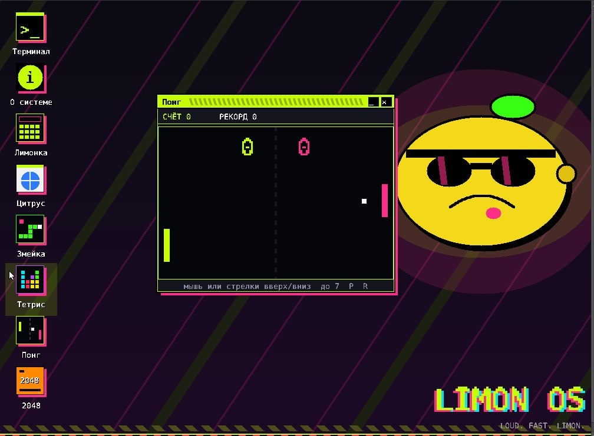
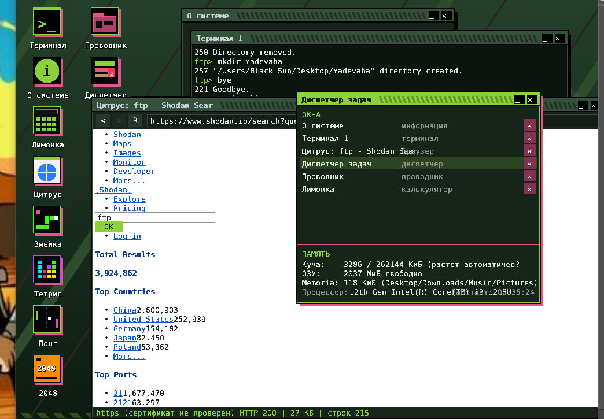
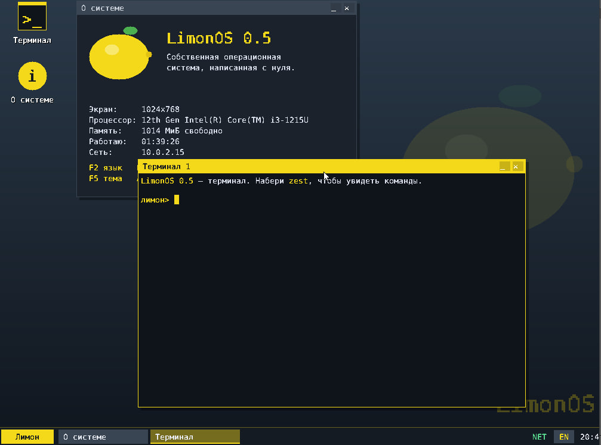
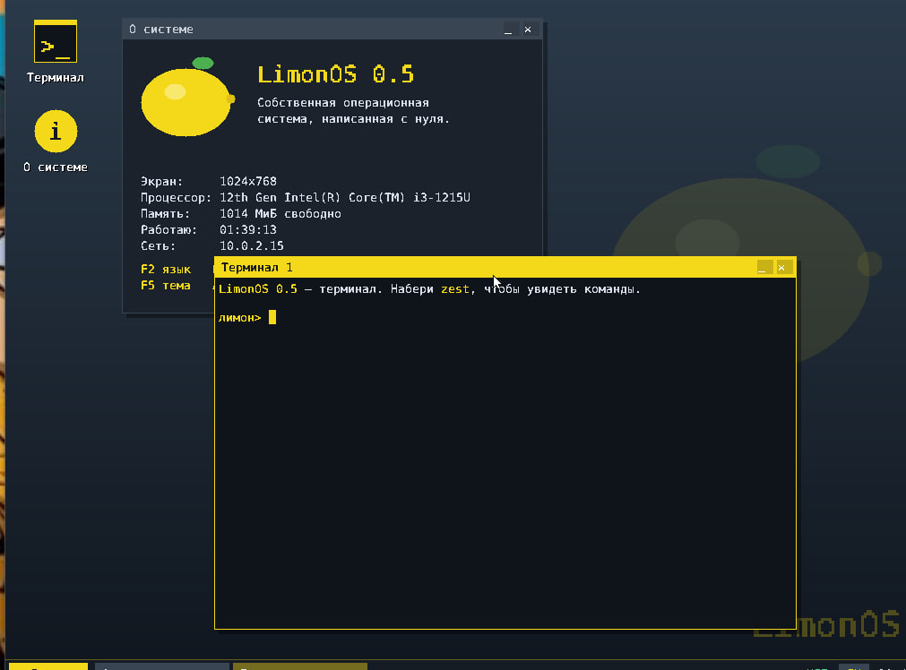
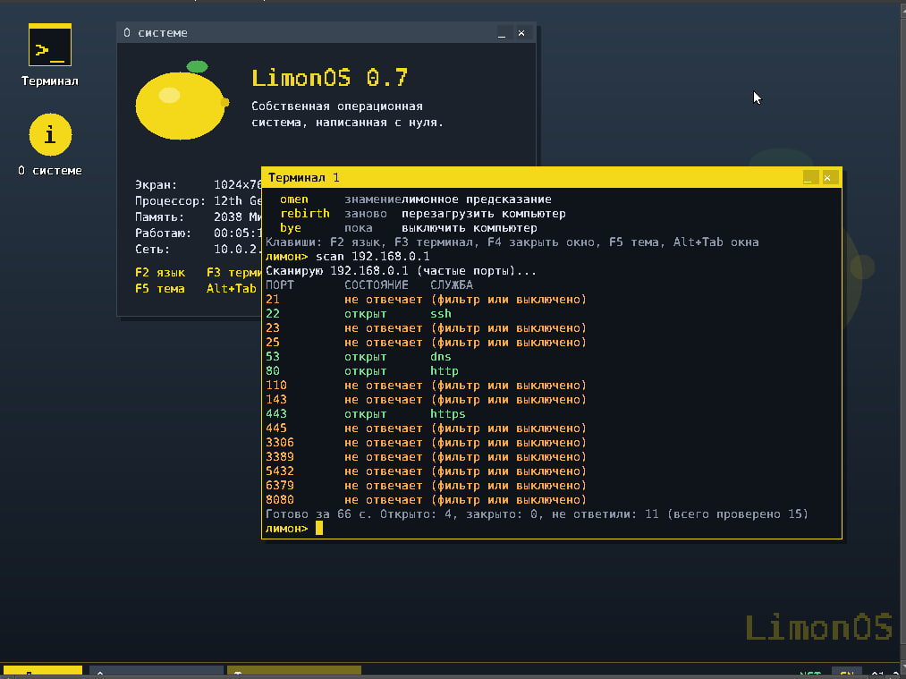
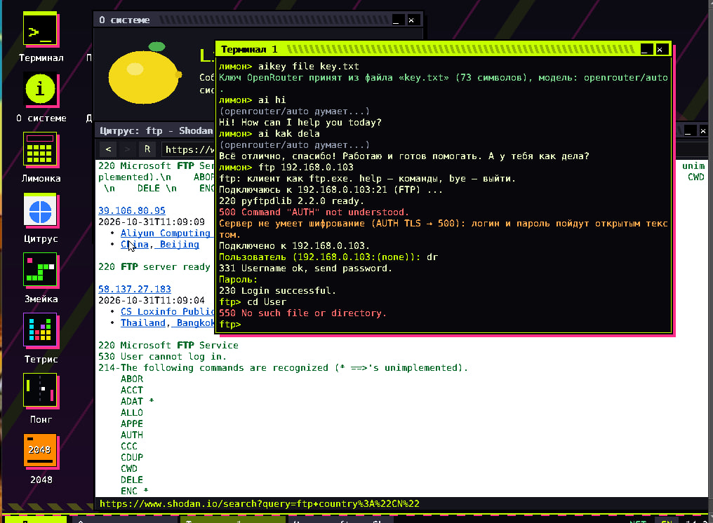
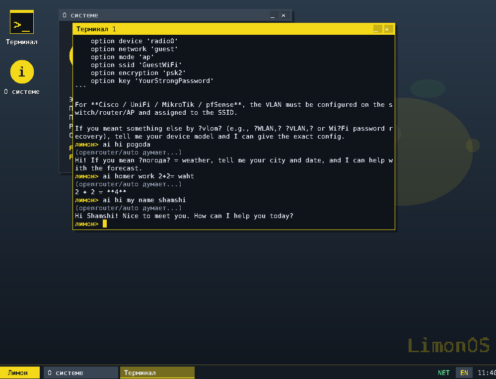

# LimonOS 🍋



Собственная операционная система с нуля (x86_64). Загрузчик: Limine.

## Что нового в 0.9: DOM + CSS в Цитрусе
Страница теперь разбирается в дерево (DOM), поверх которого работает CSS:
- селекторы: `тег`, `#id`, `.класс`, `тег.класс`, потомок (`a b`), дочерний (`a > b`), списки через запятую; специфичность и `!important`;
  стили из `<style>` и из `style="…"`; правила с `:hover`, `[attr]`, `@media` пропускаются.
- свойства: `display` (none/block/inline), `visibility`, `opacity:0` (скрытое не рисуется), `color`, `background` (фон страницы),
  `font-weight` (жирный), `text-align` (по центру/справа), `white-space:pre`; цвета `#rgb`, `#rrggbb`, `rgb()`, названия.
- страница рисуется на светлом фоне как в обычных браузерах (или на тёмном, если так задано в CSS).
- символы, которых нет в шрифте, заменяются похожими (`ʻ`→`'`, `é`→`e`, `ў`→`у`, кавычки и т.д.).
- Браузер представляется серверам как текстовый (Lynx): Google и DuckDuckGo отдают такому простую страницу, работающую БЕЗ JavaScript.
- Нет: внешних файлов CSS (`<link rel=stylesheet>`), float/position/размеров, картинок, **JavaScript** (следующий большой этап).

## Что нового в 0.8: браузер Цитрус 2
`citrus` теперь настоящее окно браузера: кнопки «назад/вперёд/обновить», адресная строка, кликабельные ссылки
(адрес под мышью виден внизу), поля ввода и кнопки форм (поиск работает), заголовки/жирный/списки/код/`pre`,
`alt` картинок, кодировка windows-1251, переходы и `<meta refresh>`, история, прокрутка и полоса прокрутки.
- `citrus` — домашняя страница с поиском (DuckDuckGo); `citrus example.com`; `citrus слова для поиска`.
- Клавиши: Ctrl+L или F6 — адрес; Enter — открыть/отправить форму; Tab — следующее поле; Alt+←/→ или Backspace — назад/вперёд;
  Ctrl+R — обновить; ↑↓ PgUp PgDn Home End Пробел — прокрутка; Esc — выйти из поля.
- Тест парсера на компьютере: `tools/hosttest/browser_test.c`.
- **Честно**: CSS, JavaScript и картинки пока НЕ поддерживаются. Сайты, целиком построенные на JavaScript (современный Google,
  YouTube, соцсети), откроются пустыми или с просьбой включить JS — это ограничение движка, а не сети.
  Для «открыть всё» нужны следующие этапы: картинки (PNG/JPEG/GIF), CSS, затем движок JavaScript — это месяцы работы.

## Что было в 0.7 (починка интернета)
В 0.6 `citrus https://…` и `lima install` на настоящих сайтах (Google, GitHub) не работали. Причины найдены и исправлены:
- **TLS**: записи у больших сайтов до 16 КБ, а буферы были 2–4 КБ → теперь буферы 16 КБ, а огромный `Certificate`
  (несколько записей) считается потоком и не хранится. Несколько handshake-сообщений в одной записи тоже разбираются.
- **TCP**: данные, пришедшие пока их никто не читает, подтверждались (ACK), но выбрасывались. Теперь у каждого
  соединения свой приёмный буфер 32 КБ, честное окно приёма, повторы/дыры/перекрытия сегментов обрабатываются.
- **Ошибки**: код ошибки TLS считался неверно, поэтому любая ошибка выглядела как «Нет ответа от сервера».
  Теперь показывается реальная причина (DNS / нет соединения / TLS: …).
- **Переходы и chunked**: `http://google.com` → `https://www.google.com` теперь идёт сам (до 6 переходов);
  ответы `Transfer-Encoding: chunked` собираются. Новая функция ядра `web_get(url, …)` — как `curl -L`.
- Куча ядра растёт по размеру памяти (до 128 МиБ); скрипты VirtualBox теперь дают ВМ 2 ГБ ОЗУ и подключают пустой диск 10 ГБ
  (диск понадобится для файловой системы, этап 7 — сама ОС его пока не использует).
- Проверки на компьютере (`tools/hosttest/`): `run.sh` гоняет тот же `tls.c` против настоящего `openssl s_server`
  (цепочка сертификатов > 16 КБ, 162 КБ данных сошлись байт в байт); `http_logic_test.c` и `tcp_logic_test.c` — разбор HTTP и приём TCP.
  Проверка прямо в LimonOS (виртуальная машина) — на твоей стороне: `citrus https://google.com`, `lima install cscan`.

## Что умело раньше (этап 6)
- **TLS 1.3** (свой, с нуля: SHA-256, HMAC, HKDF, AES-128-GCM, X25519 — все проверены по
  официальным тестовым векторам и против настоящего TLS-сервера). `citrus https://…` и
  `lima install` теперь реально работают по https, в том числе с GitHub.
- ⚠️ **Честно про безопасность**: подлинность сертификата сервера НЕ проверяется (нет
  разбора X.509 и проверки RSA/ECDSA подписи). Канал зашифрован и защищён от пассивного
  прослушивания, но ничто не подтверждает, что вы говорите именно с настоящим сайтом —
  как `curl -k`. Полноценная проверка сертификата это отдельная большая задача.
- Генератор случайности на RDRAND (с резервным вариантом для старых процессоров).

## Было раньше (этап 5)
- TCP-клиент и HTTP (GET), только http:// — без TLS перенаправления на https узнаёт и честно о них пишет
- Citrus — простой текстовый браузер: `citrus example.com`, стрелки/PgUp/PgDn — прокрутка
- `ping` как ещё одно имя команды `sonar`
- Lima — менеджер программ: `lima list`, `lima install cscan` (качает README с GitHub),
  затем `cscan <аргументы>` показывает карточку пакета (пока без запуска — нет загрузчика программ)

## Было раньше (этап 4)
- Память: менеджер страниц, куча `kmalloc`
- Шина PCI, драйвер сетевой карты Intel e1000 (её использует VirtualBox)
- Сеть Vine: ARP, IP, ICMP (ping), UDP, DHCP, DNS — выход в интернет
- Определение среды (VirtualBox, QEMU, реальное железо) по CPUID

## Было раньше (этап 3)
- Загрузка через BIOS и UEFI, свои GDT, IDT, прерывания
- Таймер (100 Гц), клавиатура PS/2 (EN + RU, переключение F2), мышь PS/2
- Рабочий стол: обои, значки, окна (перетаскивание, свернуть, закрыть),
  панель задач, меню «Лимон», 5 тем оформления, часы
- Терминал со своими командами, историей (стрелки вверх/вниз) и редактированием строки
- Данные железа: процессор (CPUID), карта памяти, часы BIOS

## Сборка и запуск (Ubuntu / Debian / WSL)
```
sudo apt install build-essential nasm qemu-system-x86 xorriso git ovmf
make iso        # соберёт ядро и образ LimonOS.iso (первый раз скачает Limine)
make run        # запуск в QEMU (BIOS)
make run-uefi   # запуск в QEMU (UEFI)
```
В QEMU мышь «захватывается» кликом по окну, освободить: Ctrl+Alt+G.

## Быстрый старт на Windows (WSL + VirtualBox)
1. Один раз: в PowerShell от администратора `wsl --install -d Ubuntu`, перезагрузка, открыть Ubuntu и задать пароль.
2. Распакуй архив в обычную папку (не запускай из архива) и дважды кликни `windows-run.bat`.
   Он соберёт образ внутри WSL, создаст виртуальную машину в VirtualBox и запустит её.
3. В окне LimonOS открой терминал и набери `vine`, `sonar 8.8.8.8`, `lookup example.com`.

## Запуск в VirtualBox (подробно)
1. Собери образ в Linux/WSL: `make iso`
2. Linux/WSL с VirtualBox: `make vbox`. Windows: запусти `scripts\vbox-create.bat`.
   Скрипт сам создаёт машину: 512 МБ, BIOS, сеть NAT с картой Intel PRO/1000 MT, мышь PS/2.
3. В системе: `vine` (адрес), `sonar 8.8.8.8` (ping), `lookup example.com` (DNS), `pci` (устройства).
Вручную: Тип «Other/Unknown (64-bit)», Система: чипсет PIIX3, включить I/O APIC, EFI выключить;
Сеть: NAT, адаптер Intel PRO/1000 MT Desktop; Указатель: PS/2 (не USB-планшет).
Мышь в VirtualBox захватывается кликом, освободить — правый Ctrl.

## Горячие клавиши
| Клавиша | Действие |
|---|---|
| F2 | раскладка RU / EN |
| F3 | новый терминал |
| F4 | закрыть активное окно |
| F5 | следующая тема |
| Alt+Tab | переключить окно |
| Ctrl+L / Ctrl+C / Ctrl+U | очистить / отменить строку / стереть строку |

## Команды терминала (у каждой есть русское имя)
| Команда | Рус. | Что делает |
|---|---|---|
| zest | цедра | список команд |
| squeeze | выжать | очистить экран терминала |
| peel | кожура | сведения о системе с лимоном |
| juice | сок | память: сколько сока осталось |
| engine | мотор | процессор и его возможности |
| sundial | время | дата и время (часы BIOS) |
| pulse | пульс | сколько система работает |
| say | сказать | повторить сказанное |
| abacus | счёты | калькулятор: `abacus 2+3*(4-1)` |
| palette | краски | цвета и темы |
| tint | оттенок | сменить тему: `tint lime` |
| lang | язык | раскладка: `lang ru` / `lang en` |
| twin | двойник | ещё один терминал |
| pci | шина | устройства материнской платы |
| ping | — | то же самое, что sonar |
| citrus | цитрус | простой браузер: `citrus example.com` |
| lima | лима | ставить программы: `lima list`, `lima install cscan` |
| vine | лоза | сеть; `vine dhcp` — получить адрес |
| sonar | эхо | ping: `sonar 8.8.8.8` |
| lookup | найти | DNS: `lookup example.com` |
| omen | знамение | лимонное предсказание |
| rebirth | заново | перезагрузка |
| bye | пока | выключение |

## Запись на флешку
Сначала проверь образ в QEMU, потом:
```
sudo ./scripts/write-usb.sh LimonOS.iso
```
Скрипт покажет диски и потребует подтверждение, данные на флешке будут стёрты.
В Windows: Rufus, режим «DD-образ».

## Структура
```
kernel/kernel.c      точка входа, запуск всех подсистем
kernel/gdt.c idt.c pic.c isr.S interrupts.c   прерывания (при ошибке ядра — экран паники)
kernel/timer.c rtc.c keyboard.c mouse.c ps2.c  устройства
kernel/gfx.c         графика с двойной буферизацией
kernel/font.c        шрифт 8x16 (генерируется tools/gen_font.py, нужен Pillow)
kernel/term.c shell.c  терминал и команды
kernel/desktop.c     рабочий стол и окна
kernel/cpuinfo.c sysinfo.c power.c  сведения о железе, питание
kernel/limine.h      мой минимальный заголовок протокола Limine
```

Here's the short English version:

---

So I built my own OS — LimonOS. Not Linux, not Unix, my own kernel, 98% C. Four days of development — already has networking, a browser, and AI right in the terminal. Yeah, I used an AI assistant, my head was killing me, tons of errors, but I understand the code, I can answer for every line. GitHub link below, on Windows you just run the bat file — it builds via WSL and Limine, check it out on a VM.

What I learned in these four days: building via bat and WSL is a time bomb, moving to Docker. Kernel tests aren't a luxury, they're survival — writing basic checks for memory, timer, disk. Browser and networking are a black hole for time, limiting scope: HTTP only, text and links only, no HTTPS. AI is fine, but the rule is iron: I don't accept code until I can explain what it does. And I'm drawing the kernel diagram right now, while there's still little code.

Forgot about "becoming like Linux" — Linux 0.01 was eight thousand lines and thirty years with thousands of people. My goal is "stably does what I need." About Terry Davis: it's cool to make my own OS like him, but he never asked "will I go crazy." I do — so I'm fine. TempleOS is a tragedy, not a role model. I do it for fun, in my free time.

LimonOS is alive. The pace is insane, but now the main thing is stability and clarity. Slowing down, locking in the foundation: build, tests, diagram. From here it takes off. Follow the development.

---


## Интерфейс скрины












## Ограничения (честно)
- Нет повторной отправки НАШИХ TCP-сегментов (в NAT VirtualBox/QEMU потерь почти не бывает, но в плохой сети запрос может зависнуть).
- Скачивать большие файлы и «всё подряд» пока некуда: нет драйвера диска и файловой системы (этап 7), всё живёт в ОЗУ. Загрузка по `web_get` ограничена буфером.
- Сайты, где всё на JavaScript (современный Google, YouTube и т.п.), в текстовом Citrus будут почти пустыми — это не ошибка сети.
- TLS есть, но без проверки сертификата (см. выше) — не используй для паролей/платежей.
- Установленные через `lima` пакеты показывают только карточку (имя, параметры, README) — запускать чужой код пока нечем, это следующий большой этап (Pulp).
- Браузер Citrus — только текст: без картинок, без переходов по ссылкам, без CSS.
- Сетевая карта только Intel e1000 (VirtualBox, QEMU `-nic model=e1000`). Для реальных ПК нужны драйверы других карт.
- Память карты сетевой карты отображается через HHDM загрузчика (кэшируемо). В VirtualBox этого достаточно, для настоящего железа нужны свои таблицы страниц.
- Только PS/2 клавиатура и мышь. На реальных ПК с USB-клавиатурой работает, если BIOS эмулирует PS/2 (Legacy USB Support); нормальный USB-драйвер (xHCI) — отдельный этап.
- Рабочий стол рисуется максимум в 1920x1080, на больших экранах занимает левый верхний угол.
- `limine.h` написан мной вручную; если команда `juice` пишет «карта памяти недоступна», замени его официальным из репозитория Limine.
- Если Limine ругается на строку `resolution:` в limine.conf, просто удали её.


## AI в терминале 



aikey <сюда ваш ключ API от openrouter.ai>

потом можно исползавать командой ai

> ai hi my name Jucy

Вот сам LimonOS0.9VAI
[Скачать готовую сборку (.zip)](https://github.com/AnonimusShamshiAlex/LimonOS/blob/main/LimonOS9_1_AI.zip)

И вот и с командой grab что бы с сервера устоновить себе нужный key.txt ключ API для ИИ в терминале
[Скачать готовую сборку (.zip)](https://github.com/AnonimusShamshiAlex/LimonOS/blob/main/LimonOS9_3.zip)


LimonOS: Как я написал с нуля 64-битное монолитное ядро со своим сетевым стеком и TLS 1.3

Дисклеймер для старта: LimonOS — это НЕ Linux. Это НЕ Unix. Это НЕ очередной дистрибутив, не форк и не сборка на базе Ubuntu/Arch.
Здесь нет ни одной строчки чужого кода операционной системы. Это чистокровное монолитное ядро, написанное с абсолютного нуля на языке C (Си) и Ассемблере под современную архитектуру x86_64. Всё, от обработки прерываний процессора до отрисовки оконного интерфейса и шифрования сетевых пакетов, написано вручную.
Большинство хобби-разработчиков ОС (OSDev) останавливаются на этапе «вывел Hello World в текстовый режим VGA и написал змейку». Я пошёл по хардкорному пути и создал живую, подключённую к интернету экосистему.

🛠 Текущая архитектура ядра

• Режим работы: Настоящий 64-битный Long Mode (elf64-x86-64). Никакого устаревшего 32-битного legacy. Компиляция под -m64 -march=x86-64.
• Загрузчик: Современный Limine с полноценной поддержкой как классического BIOS, так и UEFI.
• Низкоуровневый базис: Свои таблицы дескрипторов и прерываний (GDT, IDT), программируемый контроллер прерываний (PIC), драйверы клавиатуры/мыши (PS/2), системный таймер и часы реального времени (RTC). Полноценная инициализация шины PCI.
• Память: Кастомный менеджер физических страниц памяти + собственная куча (kmalloc/kfree). На данном этапе вся система работает в едином адресном пространстве в режиме ядра (Ring 0).

🌐 Главная уникальность: Свой сетевой стек и TLS 1.3 прямо в Ring 0

Это то, чем могут похвастаться единицы независимых проектов в мире. В ядро встроен собственный сетевой стек, написанный под сетевую карту Intel e1000:
Ethernet ➡️ ARP ➡️ IP ➡️ ICMP (Ping) ➡️ UDP ➡️ TCP ➡️ DHCP ➡️ DNS
Но и этого показалось мало. Поверх TCP я реализовал собственный протокол TLS 1.3 с самописной криптографической библиотекой! Никакого OpenSSL или MbedTLS. Всё с нуля:
• Хеширование и имитозащита: SHA-256, HMAC, HKDF
• Симметричное шифрование: AES-GCM
• Обмен ключами: X25519
Благодаря этому система способна делать безопасные HTTPS-запросы в глобальную сеть. Прямо сейчас внутри LimonOS работает терминал, который через сеть общается с ИИ-моделями (через OpenRouter API) и выводит ответы на экран. ОС буквально осознаёт свою архитектуру в реальном времени.

💻 Графика и интерфейс

Никакого консольного убожества 80х25.
• Вывод графики реализован через Framebuffer.
• Разработана собственная графическая оконная подсистема Orchard («Сад»).
• Написан кастомный терминал Zest («Цедра») с полноценной поддержкой отрисовки шрифтов и кириллицы.
• Написаны первые графические приложения (например, калькулятор «Лимонка»).

🚀 Что дальше? Впереди этап «Pulp»

Система уже умеет то, чего не умеют 99% хобби-ядер, но это только начало. Сейчас я перехожу к этапу Pulp («Мякоть»), который превратит LimonOS в классическую защищенную ОС:
1. Разделение колец привилегий процессора и изоляция (Ring 3 для пользовательских программ).
2. Собственная архитектура виртуальной памяти (страничная адресация / Paging) для защиты процессов друг от друга.
3. Многозадачность и планировщик контекста процессора.
4. Интерфейс системных вызовов (Syscalls через механизмы SYSCALL/SYSRET).
5. Виртуальная файловая система (VFS) и поддержка накопителей для запуска внешних бинарников.
Проект развивается, архитектура зафиксирована в спецификациях (docs/TZ.md), и код продолжает расти. Лимон созревает! 🍋
Как вам такой текст поста? Если нужно, я могу:
• Скорректировать тон (сделать более официальным или, наоборот, добавить ещё больше дерзкого юмора).
• Добавить блок со ссылкой на ваш GitHub (если планируете выкладывать в открытый доступ).
• Помочь перевести его на английский язык для англоязычных площадок (например, Reddit r/osdev).

Here's the short English version:

---

Built my own OS — LimonOS. Not Linux, not Unix, my own kernel, 98% C. Four days in: networking, a browser, and AI right in the terminal. Yes, I used an AI assistant — head was killing me, tons of errors — but I understand every line. GitHub link below, on Windows just run the bat file (WSL + Limine), try it on a VM.

Lessons so far: bat + WSL build is a time bomb → moving to Docker. Kernel tests aren't luxury, they're survival. Browser/networking is a time sink → HTTP only, no HTTPS for now. AI is fine, but I don't accept code I can't explain. Drawing the kernel diagram now, while it's still small.

Dropped the "be like Linux" dream — Linux 0.01 was 8k lines and 30 years with thousands of people. My goal: stably does what I need. Terry Davis made his OS alone too, but he never asked "will I go crazy." I do — so I'm fine. TempleOS is a tragedy, not a role model. Doing this for fun, in my free time.

LimonOS is alive. Pace is insane, but now it's about stability and clarity. Slowing down, locking the foundation: build, tests, diagram. Follow along.

---


## Дорожная карта
См. docs/TZ.md (части системы, уникальность, 13 этапов). Сделаны этапы 1–6. Дальше: загрузчик программ (Pulp) — без него `lima`-пакеты не запускаются;
позже — проверка сертификата (X.509/RSA/ECDSA), если понадобится настоящая безопасность.


## ENG

Чтобы репозиторий LimonOS быстро находился как в поиске самого GitHub, так и в Google/Yandex, нужно оформить **`README.md`** с хорошей ключевой структурой, ключевыми словами и правильной разметкой.

Вот готовый вариант **`README.md`** на английском языке (так как в сфере OSdev главный поисковый трафик идет на английском), который включает все ключевые слова для поисковиков:

---

```markdown
# 🍋 LimonOS — Custom 64-bit Monolithic Operating System Kernel

[](LICENSE)
[]()
[]()

**LimonOS** is a custom 64-bit monolithic operating system kernel written from scratch primarily in C. It features a standalone architecture (not Linux, not Unix-derived), a custom graphical user interface (GUI) with framebuffer rendering, direct networking support, and terminal AI capabilities.

---

## 🌟 Key Features

* **Custom x86-64 Kernel:** Built 98% in C with bare-metal low-level components.
* **Limine Bootloader:** Modern x86_64 bootloader handoff and protocol integration.
* **Graphical Desktop & UI:** Custom framebuffer rendering engine with windowing support.
* **Networking & Web Capabilities:** TCP/IP stack integration with HTTP/TLS capabilities and a built-in browser client.
* **Terminal AI Assistant:** Built-in command line interface powered by OpenRouter API (`aikey` & `ai` commands).
* **Cross-Platform Building:** Compiles easily on Windows (via WSL2) and Linux using automated `.bat` / `.sh` build scripts.

---

## 🚀 Quick Start & Building

### Prerequisites
* GCC / Clang (x86_64 cross-compiler)
* NASM / GNU Assembler
* Limine bootloader
* QEMU or VirtualBox (for running ISO/IMG)

### Building on Windows (WSL)
Execute the provided build script:
```bash
./build.bat

```

### Building on Linux

```bash
make

```

Run in QEMU:

```bash
qemu-system-x86_64 -cdrom LimonOS.iso

```

---

## 🤖 AI Terminal Integration

LimonOS supports LLM queries directly inside its built-in terminal:

1. Set your OpenRouter API key:
```text
aikey <YOUR_OPENROUTER_API_KEY>

```


2. Ask any question:
```text
ai hello, explain how kernel interrupts work

```


---

## 📚 Documentation & Wiki

For architecture details, memory management layout, driver implementations, and API references, check out our official **[LimonOS Wiki](https://www.google.com/search?q=https://github.com/AnonimusShamshiAlex/LimonOS/wiki)**:

* [Architecture Overview](https://www.google.com/search?q=https://github.com/AnonimusShamshiAlex/LimonOS/wiki/Architecture-Overview)
* [Building and Running Guide](https://www.google.com/search?q=https://github.com/AnonimusShamshiAlex/LimonOS/wiki/Building-and-Running)
* [Graphics & Framebuffer Subsystem](https://www.google.com/search?q=https://github.com/AnonimusShamshiAlex/LimonOS/wiki/Graphics-and-UI)
* [Networking & TLS Stack](https://www.google.com/search?q=https://github.com/AnonimusShamshiAlex/LimonOS/wiki/Networking-and-TLS)

---

## 🏷️ Keywords & Search Tags

`operating-system` `osdev` `kernel-development` `custom-kernel` `c-language` `x86-64` `limine-bootloader` `framebuffer-gui` `networking-kernel` `bare-metal` `hobby-os` `limonos`
