# ENG
# LimonOS 🍋

# Bare metal boot

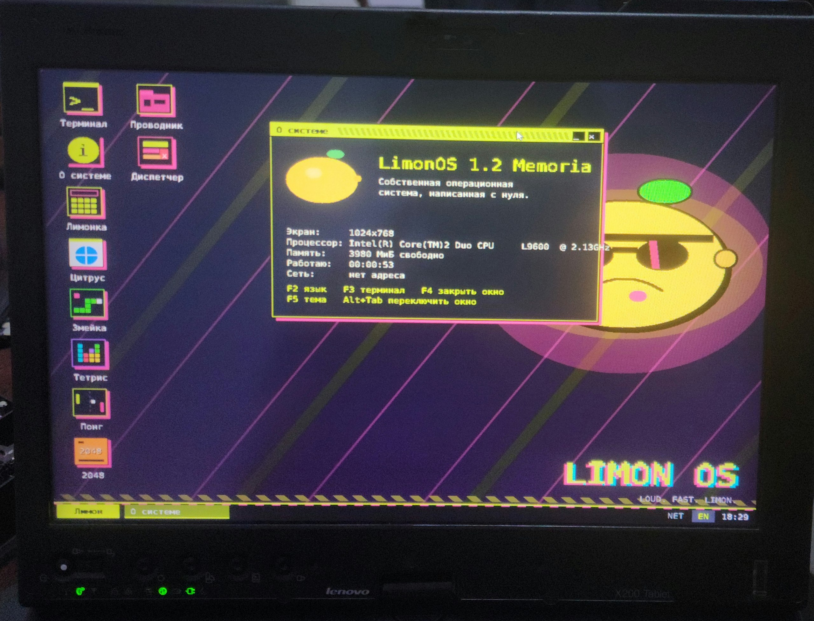


[LimonOS.iso Download](https://github.com/AnonimusShamshiAlex/LimonOS/blob/main/LimonOS.iso)

OR

https://drtoolparadox.base44.app/limonos 👈 Download

https://drive.google.com/file/d/1gw7-WKrAMfl4OKuTGrOPqMbvJf5CfUXS/view?usp=sharing FULLMAX


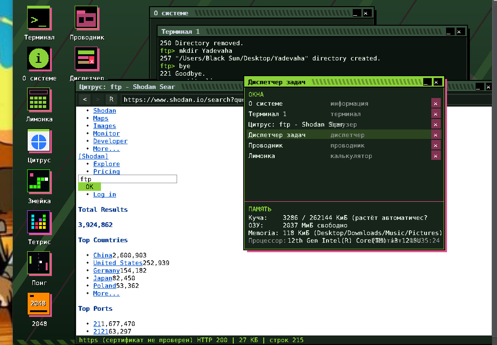

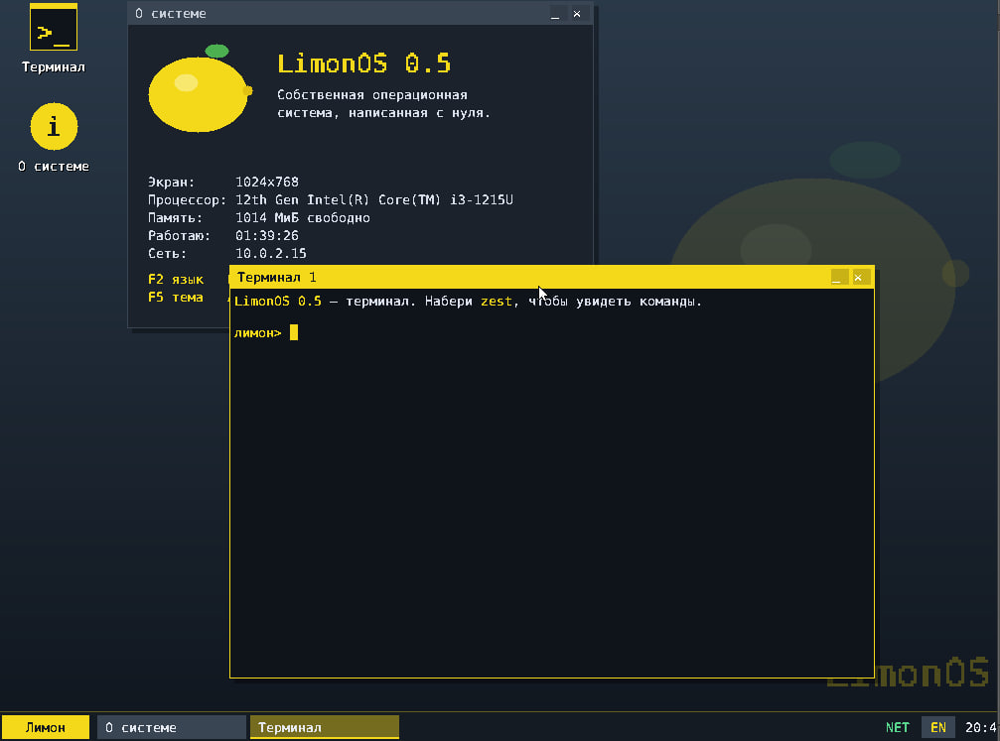

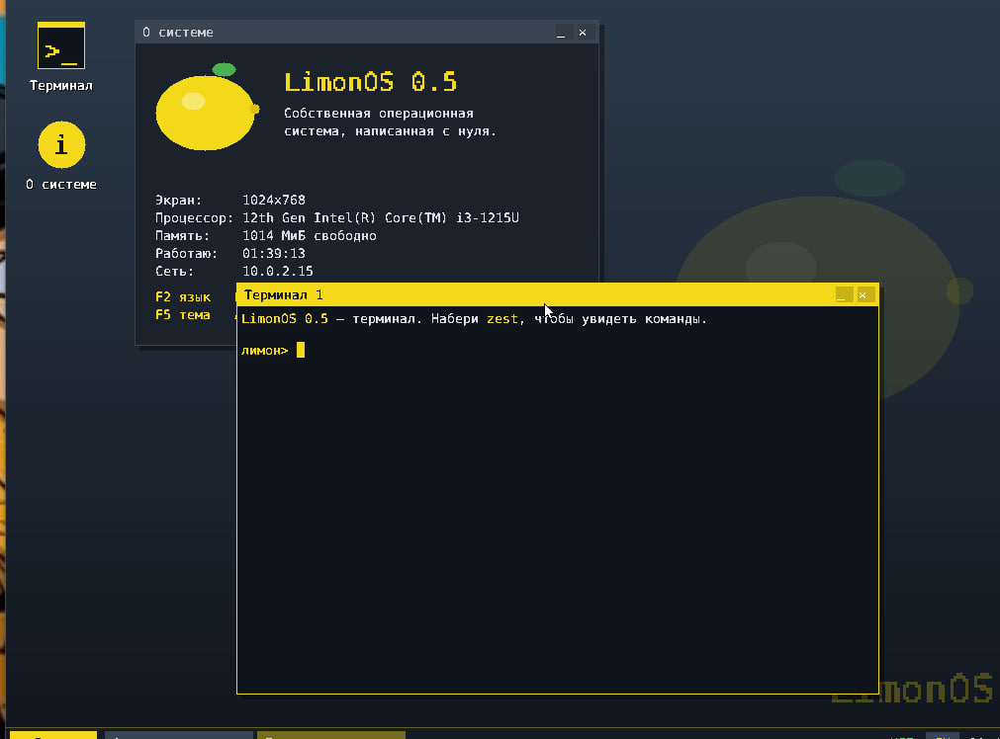

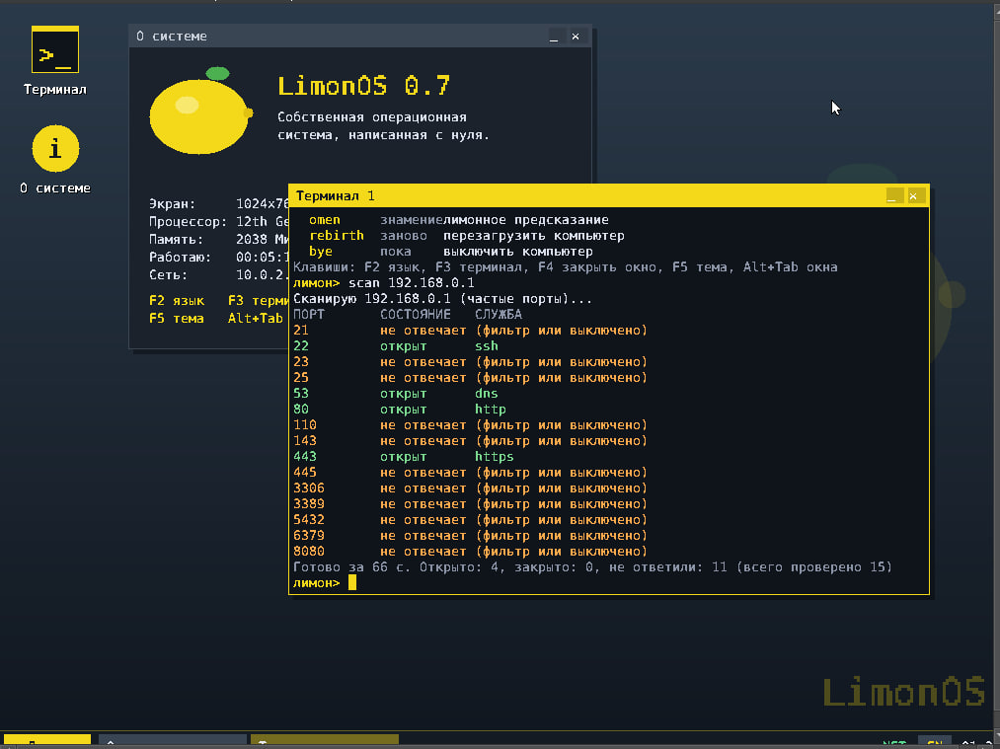

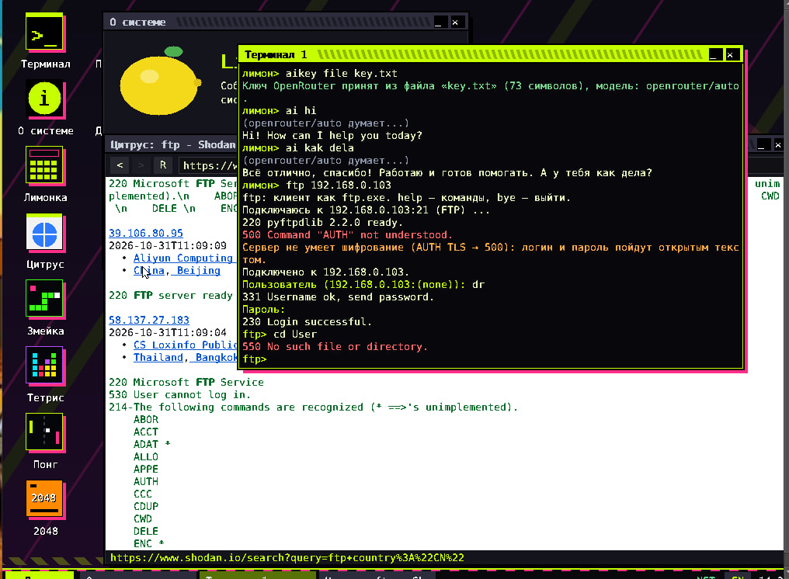

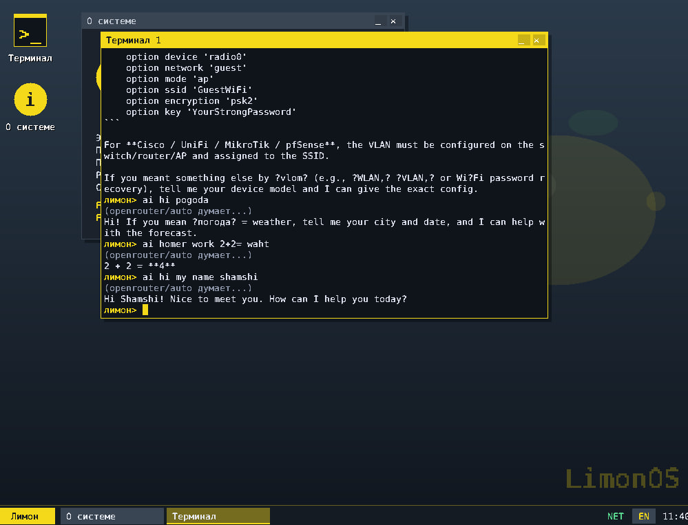

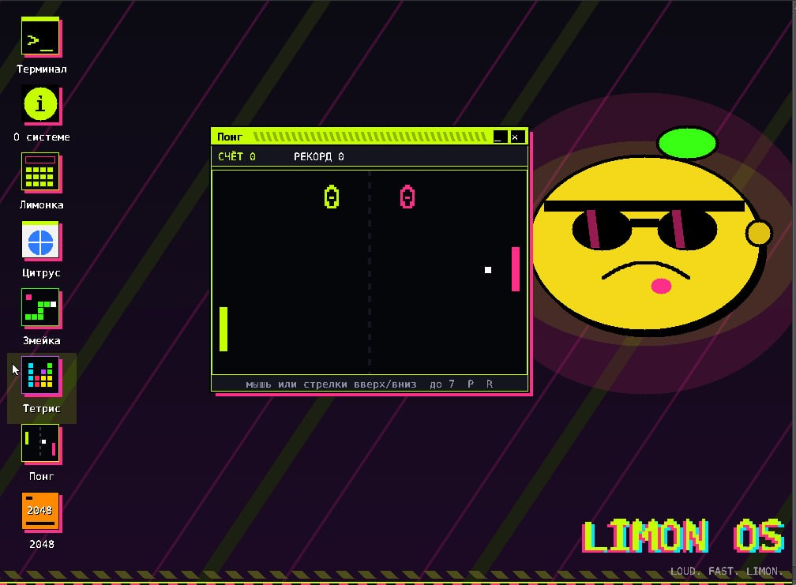

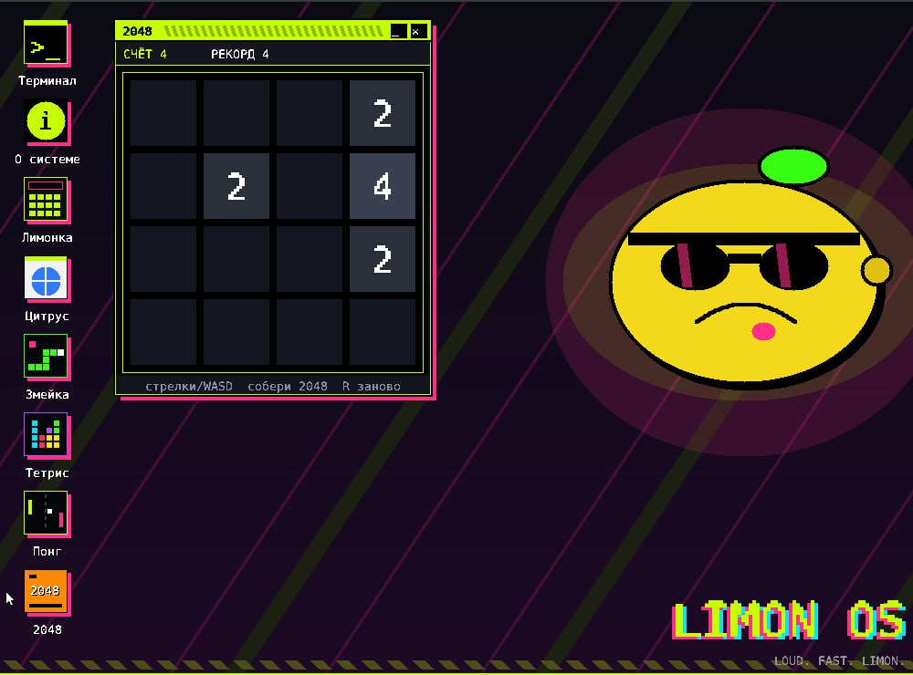

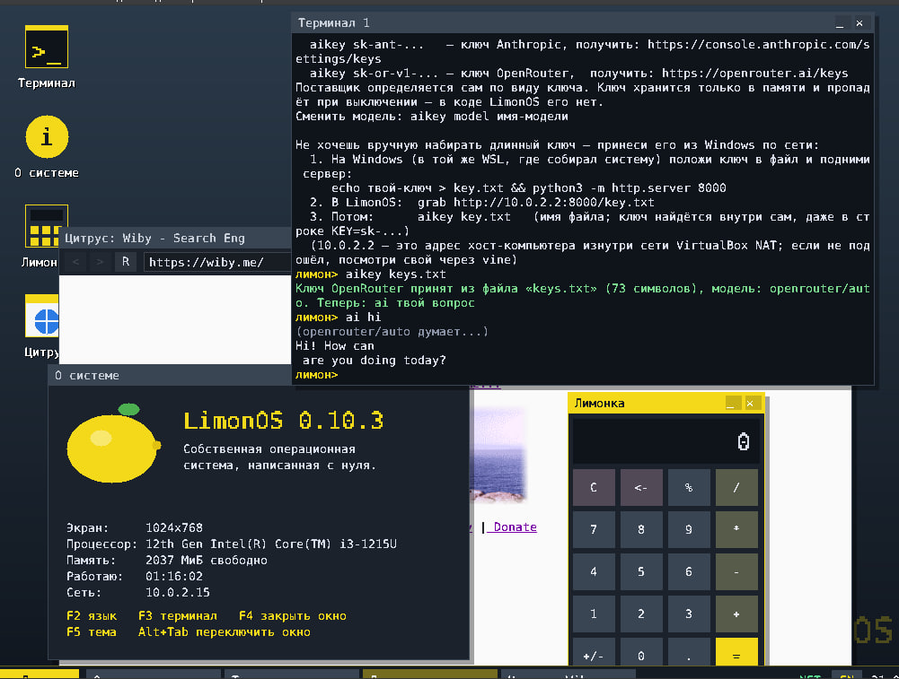

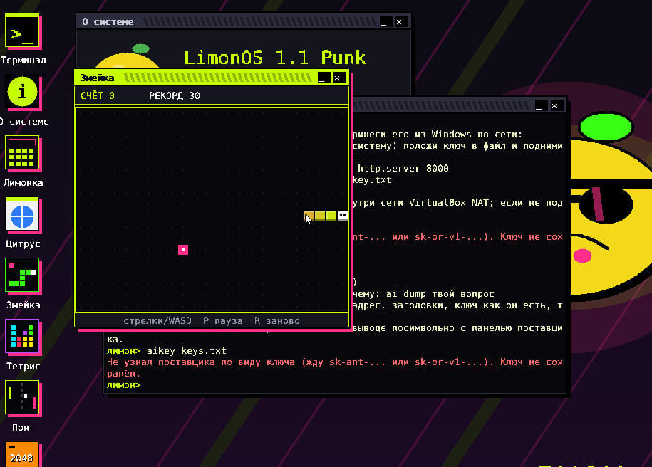

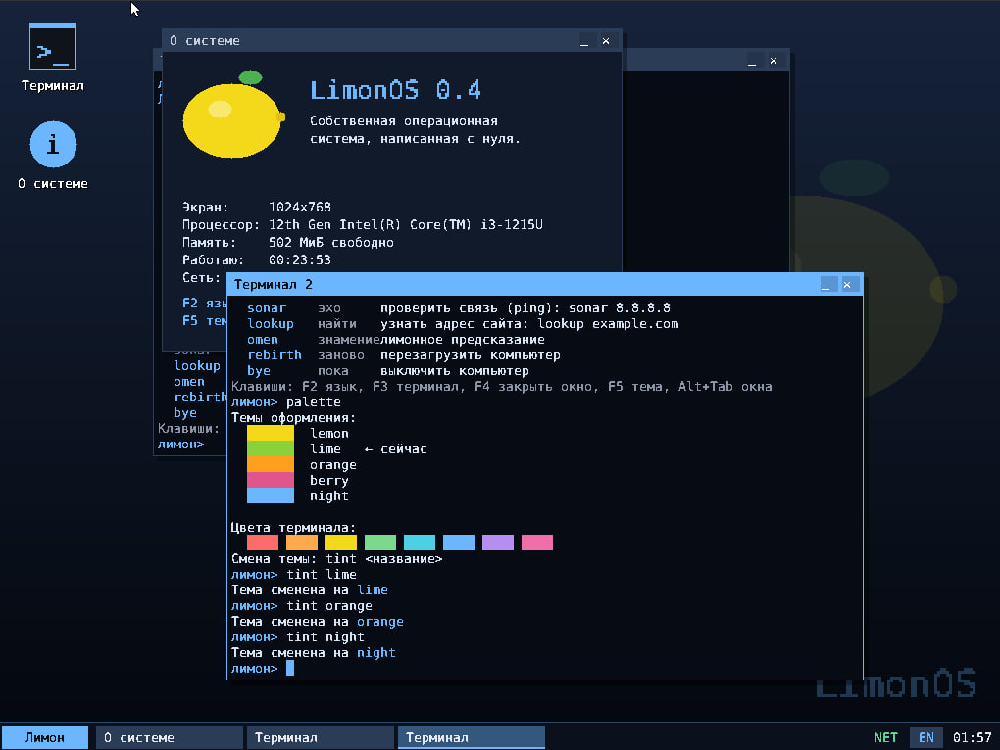

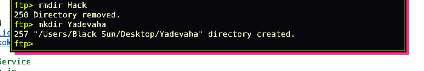

Here's the full set: https://drive.google.com/file/d/1wyHT-ArkbiyD578nqy6sQKYZ_TTgKgBH/view?usp=sharing — all versions

Here's the ISO: https://drive.google.com/file/d/1hC04tYYwzSlnmKJEU6oVDjFBrDNAF7hy/view?usp=sharing — stable

Here's the stable zip: https://drive.google.com/file/d/1bpY8QFvhDPfo0e6TPtS5QHUcCVgRu8YE/view?usp=sharing

## In progress: the path to actually running programs (see docs/USERSPACE_PLAN.md)
Below (1.2 and earlier) explains why `apt install nmap` doesn't yet install a real nmap. That
remains true. But now it's not just an explanation — it's a plan of 6 verifiable phases (1-2 are done and verified on the host, 3-5 are written and awaiting verification on QEMU).

**Phase 1 (done):** `kernel/elf.c` parses and validates a real ELF64 file (magic, class,
architecture, program headers, PT_LOAD segments, overlaps, entry point) — `tests/elf_host.c`
runs this on a real binary built with the system `ld`, and on a set of deliberately broken files.

**Phase 2 (done):** `kernel/vmm.c` — x86_64 page tables per process (PML4→PDPT→PD→PT):
map/unmap/translate address, plus a "shared upper half" between kernel and process (like
in Linux — the upper 256 PML4 entries are shared, the lower 256 are per-process).
`tests/vmm_host.c` verifies all this logic on the host through fake physical memory.

**Phase 3 (code written, everything possible verified on the host; ring3 on real hardware — you'll have to verify):**
The GDT now contains ring3 segments (data 0x1B, code 0x23) and a TSS with an `rsp0` stack
(`kernel/gdt.c`, the pure part — `kernel/ring3.h`). `kernel/user.c` + `kernel/usermode.S` create
a separate address space (its own PML4 + the shared upper half of the kernel, Phase 2), place a
tiny program into it, and do `iretq` into ring3; the kernel takes control back via an exception
or the timer. The **`ring3`** command in the LimonOS terminal runs three checks:
1. `hlt` from ring3 → #GP, while the user stack works (push/pop);
2. reading kernel memory from ring3 → #PF with code 0x5 (kernel page protection);
3. an infinite loop in ring3 → the timer (IRQ0) via the TSS stack returns control to the kernel.

`tests/gdt_host.c` (ASan/UBSan, `tests/run_host_tests.sh`) verifies on the host: descriptor bytes
(canonical values + an independent decoder), the TSS, the `iretq` frame, #PF parsing, USER
permissions on all page-table levels, the bytes of the ring3 programs themselves, and that the result
checks reject any corruption (verified with mutations). **Not verified and cannot be verified in an environment without QEMU:** that the CPU
actually accepted the GDT/TSS, executed `iretq` into ring3 and returned. This is done like this:
`make iso && make run`, in the LimonOS terminal type `ring3`. If the VM reboots —
`qemu-system-x86_64 -cdrom LimonOS.iso -m 256M -d int,cpu_reset -no-reboot` will show on which
exception (see docs/USERSPACE_PLAN.md, Phase 3 section).

**Phase 4 (code written, ring3 on real hardware — you'll have to verify):** system calls via `int 0x80`
(Linux numbers: `read`, `write`, `brk`, `exit`), real heap growth via `brk`, pointer validation
(`-EFAULT`), `-ENOSYS`. The `ring3` command now does 6 checks; `tests/syscall_host.c` verifies
the dispatcher on the host (details and exactly what hasn't been verified — in docs/USERSPACE_PLAN.md).

**Phase 5 (code written; ring3 on real hardware — you'll have to verify):** a mini-libc (`userland/`: `_start`, `read/write/brk/exit`,
string, `malloc`, `printf` without float) and the **first real ELF** `hello.elf`, built with gcc+ld and embedded into the kernel.
In the LimonOS terminal: `run hello.elf LimonOS` (or `lima run hello.elf LimonOS`); any of your own static ELFs against this set of calls
can be placed in Memoria and run the same way. The libc was verified on the host as a real Linux process and against glibc (162 thousand
printf comparisons); the loader — by actually running the loaded image. `ring3` now does 7 checks. Details and what hasn't been verified — in docs/USERSPACE_PLAN.md.

Tests — without an emulator, run by `tests/run_host_tests.sh`. What's next (system calls,
mini-libc) and why even this won't let you run a real Linux nmap — in detail in
docs/USERSPACE_PLAN.md.

## What's new in 1.2 — Memoria, File Manager, Task Manager

### The main thing: honestly about apt/nmap/python/git/msfconsole/sqlmap
You asked me to make it so that `apt install nmap` (and python, git, msfconsole, sqlmap) actually install and run these
programs — "so it works like in Termux." **This has not been done, and here's why I didn't pretend it was:**
LimonOS physically lacks what's needed to run someone else's code — there's no executable loader (ELF/PE), no
system calls, no libc, no Python/Ruby interpreters. This isn't "adding a command," it's a separate
multi-month job (writing your own loader + syscall layer + libc from scratch). Passing it off as done would be a lie.

Instead of a fake success, the `lima`/`apt`/`apt-get` command honestly responds to these packages: "someone else's program, LimonOS
can't run it yet" — and shows what already really works instead of them:
- `nmap` → **`scan`** — its own port scanner, already working.
- `sqlmap`, `msfconsole`, `wireshark` → `scan`, **`seal`** (TLS/https check), `ai` (ask the model).
- `python` → **`abacus`** — an expression calculator (`abacus 2+3*(4-1)`).
- `git` → `grab` — downloads a single file over http(s); there's no full git client.

### Memoria — real folders instead of a single file list
Previously all downloaded files sat in one flat list. Now it's a tree of folders in RAM (lives until shutdown — writing
to disk still isn't done): `/Desktop`, `/Downloads`, `/Music`, `/Pictures`, `/System`.
Commands work like in a Linux shell: `ls [path]`, `cd folder` (and `cd ..`), `pwd`, `mkdir name`, `cp`, `mv`, `rm`/`drop`,
`cat`/`peek`, `sha`, `upload`. `grab` now saves the file to the current folder (by default — `/Downloads`).

While developing, I caught a real bug myself: at the root `parent` pointed to itself, so the listing of the root folder
showed itself as a subfolder. Fixed it and pinned it with a test (`tests/vfs_host.c`), so it doesn't come back.

### File Manager (GUI)
A new window, opened by an icon, from the "Lemon" menu, or by command — double-click enters a folder, `N` — create a folder
(entering the name right in the window), `Delete` — delete the selection, the size of each file and the path are visible.

### Task Manager (GUI) + `top`/`ps`/`kill`
A list of open windows (type, title, active/minimized), close by clicking "×" or with the `kill <number>` command (the number
from `top`). Below — memory: heap usage, free RAM, Memoria size, uptime, CPU.

### Memory for heavy tasks
The heap is no longer a fixed 32 MiB: at boot it measures the real free RAM and takes half of it
for the heap (from 8 to 256 MiB), plus it can still grow further on demand. This doesn't make it possible to run msfconsole
or similar (see above, why), but on an old PC with little RAM the system now doesn't try to allocate more than it has.

### More like Linux, but not Linux
Added aliases: `top`, `ps`, `kill`, `free`, `df`, `uname`, `whoami`, `apt`/`apt-get`. `uname` says outright:
"LimonOS, not Linux and not compatible with it at the program level" — so as not to create false expectations.

### Verified (host, without hardware and without an emulator)
`tests/run_host_tests.sh` runs: format strings, games (ASan/UBSan), FAT32, **Memoria/VFS** (new, ASan/UBSan),
kernel build without warnings, and screenshots of the desktop **and the new windows** (`tests/desktop_shot2.c`) — File Manager,
creating a folder via the GUI, Task Manager.

---

## What's new in 1.1 "Punk"

### The screenshot bug (`grab` + `aikey file`) — found and fixed
There were two causes at once:
1. **You were downloading a page, not a file.** `grab http://192.168.0.113:8000 key.txt` — there's no path in the address, and `http.server`
   returned the *directory listing* (HTML, 4381 bytes, the same sha256 in both runs). The second argument is only the *name in memory*.
   Now, if there's no path in the address and a name is given, `grab` downloads `address/name` itself. If the server still sends HTML under
   a "non-html" name — it warns. `aikey file` on an HTML page honestly says "this is not a key."
2. **A bug in `format.c`:** there was no `%.47s` precision. The file name was saved and printed literally as `%.47s`
   (that's why `files` showed `%.47s`, and `aikey file key.txt` couldn't find the file). Now `%.N`, `%.*s`, `%*d`, `z`, `h` are supported.

### Security and stability
- Heap: block tags, protection against double/foreign `kfree`, protection against size overflow, `kcalloc`, **automatic heap growth**
  (previously on exhausting 32 MiB — `NULL`), merging only physically adjacent blocks.
- API key: doesn't get into command history (↑), wiped on the stack, `ai dump` shows only the beginning/end.
- File names in memory: `/`, `\`, control characters forbidden; UTF-8 trimming without breaking a character.
- **Proxy mode** `aikey proxy http://192.168.0.5:8787 [anthropic|openrouter]` + `tools/ai_proxy.py`: the old PC speaks over
  plain HTTP, only the main PC stores the key (it isn't in LimonOS at all), TLS isn't needed on the old CPU.
- Screen: RGB/BGR support, 16/24/32 bit and arbitrary pitch (on a non-standard format we draw to a buffer and convert colors).

### Hardware
- **Realtek RTL8139** (`rtl8139.c` driver) alongside Intel e1000, automatic selection (`nic.c`).
- **ATA PIO + FAT32 (read-only)**: `disks`, `ls [path]`, `load file [name]`; long names, Cyrillic, MBR.
  Example: put `KEY.TXT` on a FAT32 disk → `load KEY.TXT` → `aikey file KEY.TXT`.
- ⚠ **Honestly:** RTL8139 and ATA were written to spec and have NOT yet been run on real hardware (there's no emulator in this environment).
  FAT32 and the games were verified on the host; the desktop — with screenshots on the host. USB flash drives, AHCI and NVMe aren't supported yet.

### "Punk" style and games
- New main theme **punk** (dark, acid lime + pink), also **riot** and **vapor**; the old themes remain (`tint lemon`).
  Windows with black outlines and a hard shadow, hatched title bars, a lemon in glasses, a glitch logo, wallpaper cache (faster on an old PC).
- Games (desktop icons, "Lemon" menu, `play` command): **Snake, Tetris, Pong (mouse or arrows), 2048**.
  They start paused, pause themselves when you switch to another window, records live until shutdown.
- Verification: `tests/run_host_tests.sh` (format, games under ASan/UBSan, FAT32, build without warnings, desktop screenshots).

### Known gaps (still)
No TLS certificate verification (so the proxy is the preferred path for AI), no USB, no writing to disk,
no running ELF/.exe, no sound.

---


An operating system of my own, from scratch (x86_64). Bootloader: Limine.

## What's new in 1.0: merging all branches into one system
I combined into one LimonOS what until then had grown in four separate archives:

- **ai / aikey** — talking to Claude or other models via OpenRouter right in the terminal (already there)
- **The "Limonka" Calculator** — a separate window on the desktop, its own fixed-point arithmetic
  (no loss of precision like `0.1+0.2=0.3`, not `0.30000000004`), by mouse or keyboard
- **The new Citrus browser** — a full engine: CSS parsing (colors, classes, selectors), forms
  (GET/POST, buttons), back/forward history, address bar, relative links, windows-1251 encoding
  for old Russian sites, `<meta refresh>`. Works through my already-verified
  HTTP/TLS client (I didn't touch it — it was reliable, it stayed reliable)
- **scan** (its own port scanner) — as it was, unchanged

### A serious bug I found and fixed during the merge
The ported browser's `struct page` (counters for lines/links/forms/input fields) was never zeroed
at the start of `page_render()`. If the calling code declares `struct page pg;` on the stack in the usual way
(without explicit initialization — and that's exactly how it's used) — the counters start with garbage from the stack.
For a page with `<form>` this meant writing `pg->forms[pg->nforms]` at a random index — sometimes
it worked, sometimes not, depending on what had been in memory before. I caught this not by guessing:
- first I reproduced the instability (3 out of 5 runs crashed on the same page)
- enabled deterministic glibc heap corruption (`MALLOC_PERTURB_`), stack tracing via `backtrace()`
  and `addr2line` — without a single external debugger, only what's in the system
- narrowed it down to a minimal case: `<form></form>` with no attributes at all still crashes on the 4th attempt
- after the fix (one `memset(pg, 0, sizeof *pg)` at the start of `page_render`) — 0 crashes out of 50 attempts
  on the minimal case, 0 out of 50 on the full page, 0 out of 20 over the real network

## What's new in 0.9.3: transferring text from Windows without manual typing
A real shared clipboard with Windows in VirtualBox is a separate driver (VirtualBox Guest
Additions, VMMDev + HGCM protocol, a virtual PCI device). I didn't take it on: in my
sandbox there's no VirtualBox itself, so I can neither verify nor even see this device —
handing over an unverified binary protocol would be dishonest.

Instead — a working method through what we've already verified: the network. Put the key in a file on
Windows, bring up a local server with one command, download the file with the `grab` command, and then:

**`aikey file file-name`** — takes the key right from the already downloaded file (as after `grab`), trims `\n`, `\r\n` (if the file is from Windows) and the surrounding spaces itself, and determines the provider itself.
The hint with the exact steps is now built in — just type `aikey` without arguments.

I verified the trimming logic separately: `\n` line break, `\r\n` from Windows, surrounding spaces without
a line break, an empty file, text without any signs of a key — all cases are handled correctly.

## What's new in 0.9.2: diagnosing "User not found" from OpenRouter
Based on the third screenshot: the key in LimonOS matches the key in the OpenRouter panel character for character
(and the status there is "Enabled"), but the server consistently responds `401: User not found.` — and this is a REAL
response from the real OpenRouter server (not a disconnect, not a timeout), which means TLS and HTTPS definitely work.

I read the request-building code — I found no errors. I verified with a separate test on the host: with the key
"sk-or-v1-4b5bef...2d426f7" (72 characters), the key goes into the `Authorization: Bearer` header byte
for byte, without truncation and without distortion. That is, on the LimonOS side the request is formed correctly —
guessing further from the code is pointless, I need to see the real bytes on real hardware.

I added the **`ai dump <question>`** command — it shows EXACTLY what will go to the server (address,
headers, key unmasked, request body), without sending anything. It uses the same request-building code
as the real `ai` (not a separate copy) — that is, what you see in dump is what will fly.
Compare the `ai dump` output with the key from the OpenRouter panel character by character — if it matches (and logically
it should), then the problem isn't LimonOS but the key/account on the OpenRouter side:
- try waiting 1-2 minutes after creating the key (OpenRouter has an activation delay)
- check the same key outside LimonOS (e.g. via curl or the openrouter.ai site) — if it's also
  "User not found" there, then the problem is definitely not in our code

## What's new in 0.9.1: found the cause of "?" instead of " in long commands
In your second screenshot you can see: when typing a long key, a "?" appeared on the left instead of the expected
"«" — the scroll indicator. The cause is a classic C bug: I wrote `(uint32_t)'\xab'`, and `char`
on this compiler is signed, so 0xAB (171) first became -85, and when extended to uint32_t
it became 0xFFFFFFAB instead of 0x000000AB — the font doesn't find such a "character" and draws "?" as a substitute.
Fixed it to the direct literal `0xAB` — no intermediate char, no sign extension.
Confirmed on the host with a small C program: `(uint32_t)'\xab'` = 0xffffffab, `(uint32_t)0xAB` = 0x000000ab.

**Important**: the key itself was entered and accepted correctly — the bug was only in drawing the scroll
indicator, the actually entered string wasn't corrupted. And the `401: User not found.` response in your
screenshot is a response from the real OpenRouter server (not a LimonOS error): it means TLS, HTTPS and JSON
parsing all worked correctly against the real internet, but the OpenRouter key itself wasn't recognized —
most likely a typo when entering it (hard to notice because of the "?" on the screen) or the key isn't active.
Recheck the key at openrouter.ai/keys and enter it again — it will work now.

## What's new in 0.9: two real bugs from your screenshot — fixed
Based on the VirtualBox screenshot, two real bugs were found (not in the sandbox — in your run):

1. **The input line was cut off at the 72nd character** — so you couldn't finish typing the long API key.
   Now the input line scrolls horizontally (like in a normal terminal): the limit was raised
   to 1024 characters, when the screen width is insufficient "«" and "»" appear at the edges, the cursor is always visible.
   Verified by exhaustive testing: typing, moving the cursor to any position and deleting for ALL
   line lengths from 1 to 1024 characters — the cursor never once went off the edge of the screen.

2. **`aikey` only understood Anthropic keys (`sk-ant-...`)**, but yours turned out to be an OpenRouter
   key (`sk-or-v1-...`) — that's why `ai` couldn't work, even if the key had been entered in full.
   Now `aikey` recognizes both formats itself and contacts the right service:
   - `sk-ant-...` → Anthropic (api.anthropic.com, default model claude-haiku-5-5)
   - `sk-or-v1-...` → OpenRouter (openrouter.ai, default model openrouter/auto — picks itself)
   The `aikey model name` command lets you change the model manually for either of the two.

I found and verified both bugs with tests BEFORE giving them to you: exhaustive testing for scrolling (1..1024
characters) and simulation of both API servers (Anthropic and OpenRouter) with quotes, line breaks,
unicode via \u and a wrong key (401) — all five scenarios pass.

**The main thing, honestly**: the line scrolling itself and JSON parsing are verified exhaustively. But whether
the REAL api.anthropic.com or openrouter.ai will actually respond to your key — that's the first real check
on your hardware, I still have no internet here. If `ai` still doesn't respond — send me what the terminal
shows, and we'll figure it out further.

## What's new in 0.8: google actually works now, ai right in the terminal
- `google` now goes to DuckDuckGo (html.duckduckgo.com) — simple markup without JS specifically for such cases, previously it parsed Google and hit captchas/different layouts
- **`ai <question>`** — talking with Claude right from the LimonOS terminal, over https, via the Anthropic API. Key: `aikey sk-ant-...` (stored only in session memory, it isn't and won't be in the code). Default model — claude-haiku-5-5, change it: `aikey model <name>`
- The HTTP client learned its own headers (needed for the API key) — `extra_headers` in http_opts
- JSON parsing in ai.c: found and fixed two of my own bugs with tests — the search took the first occurrence of the word instead of the key, and the escaped quote `\"` inside the text wrongly terminated the string. Verified with a host test simulating the Anthropic server (quotes, `\u`-unicode, line break, 401 error)
- **Note**: the ai command was not tested against the real api.anthropic.com (there's no internet in the sandbox) — the logic and JSON parsing were verified on a simulation, but see what it responds with on a real key, and write if something's wrong

## What's new in 0.7: port scanner, search, gzip protection
- `scan <host> [port(s)]` — its own port scanner (a replacement for nmap, which can't be run on LimonOS — see "Why not nmap" below). Distinguishes open/closed(RST)/no response
- `google <query>` — search from the terminal and the Citrus browser, over https
- The HTTP client honestly refuses if the server sent gzip/br instead of plain text (`HTTP_E_ENCODING`), rather than showing garbage — gzip decompression will be a separate step
- tcp_connect now distinguishes "port closed" (RST received, no need to wait) and "port filtered/no response"

### Why you can't run real nmap and Telegram in LimonOS
These are ready-made programs for Linux: dozens of Linux kernel system calls, libraries (OpenSSL, ncurses, and for Telegram also Qt for the interface). To run them "as is," you need a compatibility layer on the level of Wine — that's a separate multi-year project, not the next step. LimonOS's path is different and already in the spec (the Pulp stage): its own program loader + its own small utilities for its own instruction set. `scan` is exactly that "own nmap" on this path.

## What's new in 0.6: https and reliable TCP
- **TLS 1.3** (my own, from scratch): X25519, ChaCha20-Poly1305 and AES-128-GCM, SHA-256, HKDF. Files: `crypto.c`, `tls.c`
- **HTTP client** `http.c`: https, redirects (301/302/303/307/308), chunked, Content-Length, POST/PUT. https→http redirect is forbidden
- **Reliable TCP**: retransmission of lost segments, SACK, fast retransmit, RTT estimation, 64 KB receive buffer with an honest window, out-of-order packet reassembly
- Commands: `grab <url> [name]` (download to memory), `files`, `peek name [hex]`, `sha name`, `drop name`, `upload name <url> [put]`, `seal host` (TLS check), `citrus <url>` now understands https, `lima` downloads from GitHub over https
- Heap 32 MiB; virtual machine: 2 GB memory, 2 cores, 10 GB disk (the disk will work after the AHCI/FAT32 driver — stage 7)
- **Note:** the server certificate is NOT verified yet (traffic is encrypted, but there's no protection against server spoofing). The commands show the SHA-256 fingerprint of the certificate — it can be checked via `openssl s_client`. Chain verification is the next step

## Tests (on regular Linux, without running the OS)
```
python3 tests/test_crypto.py     # ciphers against hashlib/cryptography and RFC vectors
tests/run_tls_test.sh            # our TLS against a real OpenSSL server
sudo tests/run_netstack_test.sh  # the entire LimonOS network stack via TAP: http/https, redirect, chunked, upload, packet loss
```

## What it can do (stage 5)
- TCP client and HTTP (GET), only http:// — it recognizes redirects to https without TLS and honestly reports them
- Citrus — a simple text browser: `citrus example.com`, arrows/PgUp/PgDn — scrolling
- `ping` as another name for the `sonar` command
- Lima — program manager: `lima list`, `lima install cscan` (downloads the README from GitHub),
  then `cscan <arguments>` shows the package card (no running yet — there's no program loader)

## What was before (stage 4)
- Memory: page manager, `kmalloc` heap
- PCI bus, Intel e1000 network card driver (used by VirtualBox)
- Vine network: ARP, IP, ICMP (ping), UDP, DHCP, DNS — internet access
- Environment detection (VirtualBox, QEMU, real hardware) via CPUID

## What was before (stage 3)
- Booting via BIOS and UEFI, own GDT, IDT, interrupts
- Timer (100 Hz), PS/2 keyboard (EN + RU, F2 switching), PS/2 mouse
- Desktop: wallpaper, icons, windows (dragging, minimize, close),
  taskbar, "Lemon" menu, 5 themes, clock
- Terminal with its own commands, history (up/down arrows) and line editing
- Hardware data: processor (CPUID), memory map, BIOS clock

## Build and run (Ubuntu / Debian / WSL)
```
sudo apt install build-essential nasm qemu-system-x86 xorriso git ovmf
make iso        # will build the kernel and the LimonOS.iso image (downloads Limine the first time)
make run        # launch in QEMU (BIOS)
make run-uefi   # launch in QEMU (UEFI)
```
In QEMU the mouse is "captured" by clicking on the window, release it: Ctrl+Alt+G.

## Quick start on Windows (WSL + VirtualBox)
1. Once: in PowerShell as administrator `wsl --install -d Ubuntu`, reboot, open Ubuntu and set a password.
2. Unpack the archive into a regular folder (don't run it from the archive) and double-click `windows-run.bat`.
   It will build the image inside WSL, create a virtual machine in VirtualBox and launch it.
3. In the LimonOS window open the terminal and type `vine`, `sonar 8.8.8.8`, `lookup example.com`.

## Running in VirtualBox (in detail)
1. Build the image in Linux/WSL: `make iso`
2. Linux/WSL with VirtualBox: `make vbox`. Windows: run `scripts\vbox-create.bat`.
   The script creates the machine itself: 512 MB, BIOS, NAT network with an Intel PRO/1000 MT card, PS/2 mouse.
3. In the system: `vine` (address), `sonar 8.8.8.8` (ping), `lookup example.com` (DNS), `pci` (devices).
Manually: Type "Other/Unknown (64-bit)", System: PIIX3 chipset, enable I/O APIC, EFI off;
Network: NAT, Intel PRO/1000 MT Desktop adapter; Pointing: PS/2 (not a USB tablet).
The mouse in VirtualBox is captured by clicking, release it — right Ctrl.

## Hotkeys
| Key | Action |
|---|---|
| F2 | RU / EN layout |
| F3 | new terminal |
| F4 | close the active window |
| F5 | next theme |
| Alt+Tab | switch window |
| Ctrl+L / Ctrl+C / Ctrl+U | clear / cancel line / erase line |

## Terminal commands (each has a Russian name)
| Command | Rus. | What it does |
|---|---|---|
| zest | цедра | list commands |
| squeeze | выжать | clear the terminal screen |
| peel | кожура | system info with a lemon |
| juice | сок | memory: how much juice is left |
| engine | мотор | processor and its capabilities |
| sundial | время | date and time (BIOS clock) |
| pulse | пульс | how long the system has been running |
| say | сказать | repeat what was said |
| abacus | счёты | calculator: `abacus 2+3*(4-1)` |
| palette | краски | colors and themes |
| tint | оттенок | change theme: `tint lime` |
| lang | язык | layout: `lang ru` / `lang en` |
| twin | двойник | another terminal |
| pci | шина | motherboard devices |
| ping | — | the same as sonar |
| citrus | цитрус | simple browser: `citrus example.com` |
| lima | лима | install programs: `lima list`, `lima install cscan` |
| vine | лоза | network; `vine dhcp` — get an address |
| sonar | эхо | ping: `sonar 8.8.8.8` |
| lookup | найти | DNS: `lookup example.com` |
| omen | знамение | lemon prediction |
| rebirth | заново | reboot |
| bye | пока | shutdown |

## Writing to a flash drive
First check the image in QEMU, then:
```
sudo ./scripts/write-usb.sh LimonOS.iso
```
The script will show the disks and require confirmation, the data on the flash drive will be erased.
On Windows: Rufus, "DD-image" mode.

## Structure
```
kernel/kernel.c      entry point, starts all subsystems
kernel/gdt.c idt.c pic.c isr.S interrupts.c   interrupts (on a kernel error — panic screen)
kernel/timer.c rtc.c keyboard.c mouse.c ps2.c  devices
kernel/gfx.c         graphics with double buffering
kernel/font.c        font 8x16 (generated by tools/gen_font.py, needs Pillow)
kernel/term.c shell.c  terminal and commands
kernel/desktop.c     desktop and windows
kernel/cpuinfo.c sysinfo.c power.c  hardware info, power
kernel/limine.h      my minimal Limine protocol header
```

## Limitations (honestly)
- Sites almost always ask for HTTPS (TLS), and we only have plain http so far — `citrus`/`lima` will honestly say so if the site redirects.
- Packages installed via `lima` only show a card (name, parameters, README) — there's nothing to run someone else's code with yet, that's the next big stage (Pulp).
- The Citrus browser is text-only: no images, no following links, no CSS.
- Network card only Intel e1000 (VirtualBox, QEMU `-nic model=e1000`). Real PCs need drivers for other cards.
- The network card's memory is mapped via the bootloader's HHDM (cacheable). In VirtualBox that's enough, real hardware needs its own page tables.
- Only PS/2 keyboard and mouse. On real PCs with a USB keyboard it works if the BIOS emulates PS/2 (Legacy USB Support); a proper USB driver (xHCI) is a separate stage.
- The desktop is drawn at most at 1920x1080, on larger screens it occupies the top-left corner.
- `limine.h` was written by me by hand; if the `juice` command says "memory map unavailable," replace it with the official one from the Limine repository.
- If Limine complains about the `resolution:` line in limine.conf, just delete it.

## Roadmap
See docs/TZ.md (parts of the system, uniqueness, 13 stages). Stages 1–5 and TLS are done. Next: certificate verification, disk driver + FAT32 (10 GB), program loader (Pulp).


## ftp — like ftp.exe in Windows

```
lemon> ftp 192.168.0.103
Connecting to 192.168.0.103:21 (FTP) ...
220 Microsoft FTP Service
Connected to 192.168.0.103.
User (192.168.0.103:(none)): dr
331 Password required
Password:
230 User logged in.
ftp> ls
ftp> cd "Program Files"
ftp> get file.txt
ftp> bye
```

* `ftp` without a host just opens `ftp>`; you can connect with the `open host [port]` command.
* Nothing is executed on its own: neither `ls`, nor `get`, nor exit. You leave `ftp>` only with `bye` / `quit`.
  A command error, wrong password, connection loss or Ctrl+C keeps you in `ftp>`.
* Commands: open, close, user, ls, dir, cd, cdup, pwd, l

# Rus
# LimonOS 🍋


вот на фулл https://drive.google.com/file/d/1wyHT-ArkbiyD578nqy6sQKYZ_TTgKgBH/view?usp=sharing все версии

вот на исо https://drive.google.com/file/d/1hC04tYYwzSlnmKJEU6oVDjFBrDNAF7hy/view?usp=sharing стабил

вот на стабил зип https://drive.google.com/file/d/1bpY8QFvhDPfo0e6TPtS5QHUcCVgRu8YE/view?usp=sharing

## В работе: путь к настоящему запуску программ (см. docs/USERSPACE_PLAN.md)
Ниже (1.2 и раньше) объяснено, почему `apt install nmap` пока не ставит настоящий nmap. Это
остаётся правдой. Но теперь это не просто объяснение — это план из 6 проверяемых фаз (1-2 готовы и проверены на хосте, 3-5 написаны и ждут проверки на QEMU).

**Фаза 1 (готово):** `kernel/elf.c` разбирает и проверяет настоящий ELF64-файл (магия, класс,
архитектура, program header'ы, PT_LOAD-сегменты, пересечения, точка входа) — `tests/elf_host.c`
гоняет это на реальном бинарнике, собранном системным `ld`, и на наборе намеренно битых файлов.

**Фаза 2 (готово):** `kernel/vmm.c` — таблицы страниц x86_64 на процесс (PML4→PDPT→PD→PT):
отображение/снятие/перевод адреса, плюс "общая верхняя половина" между ядром и процессом (как
в Linux — верхние 256 записей PML4 расшарены, нижние 256 у каждого процесса свои).
`tests/vmm_host.c` проверяет всю эту логику на хосте через поддельную физическую память.

**Фаза 3 (код написан, на хосте проверено всё, что можно; ring3 на железе — проверять тебе):**
GDT теперь содержит сегменты ring3 (данные 0x1B, код 0x23) и TSS со стеком `rsp0`
(`kernel/gdt.c`, чистая часть — `kernel/ring3.h`). `kernel/user.c` + `kernel/usermode.S` создают
отдельное адресное пространство (свой PML4 + общая верхняя половина ядра, Фаза 2), кладут в него
крошечную программу и делают `iretq` в ring3; ядро забирает управление обратно по исключению
или по таймеру. Команда **`ring3`** в терминале LimonOS запускает три проверки:
1. `hlt` из ring3 → #GP, при этом стек пользователя работает (push/pop);
2. чтение памяти ядра из ring3 → #PF с кодом 0x5 (защита страниц ядра);
3. бесконечный цикл в ring3 → таймер (IRQ0) через стек TSS возвращает управление ядру.

`tests/gdt_host.c` (ASan/UBSan, `tests/run_host_tests.sh`) проверяет на хосте: байты дескрипторов
(канонические значения + независимый декодер), TSS, кадр `iretq`, разбор #PF, права USER на всех
уровнях таблиц страниц, байты самих ring3-программ, и что проверки результата отвергают любую порчу
(проверено мутациями). **Не проверено и не может быть проверено в среде без QEMU:** что процессор
реально принял GDT/TSS, выполнил `iretq` в ring3 и вернулся. Это делается так:
`make iso && make run`, в терминале LimonOS набрать `ring3`. Если виртуалка перезагрузилась —
`qemu-system-x86_64 -cdrom LimonOS.iso -m 256M -d int,cpu_reset -no-reboot` покажет, на каком
исключении (см. docs/USERSPACE_PLAN.md, раздел Фазы 3).

**Фаза 4 (код написан, ring3 на железе — проверять тебе):** системные вызовы через `int 0x80`
(номера Linux: `read`, `write`, `brk`, `exit`), настоящий рост кучи через `brk`, проверка указателей
(`-EFAULT`), `-ENOSYS`. Команда `ring3` теперь делает 6 проверок; `tests/syscall_host.c` проверяет
диспетчер на хосте (подробности и что именно не проверено — в docs/USERSPACE_PLAN.md).

**Фаза 5 (код написан; ring3 на железе — проверять тебе):** мини-libc (`userland/`: `_start`, `read/write/brk/exit`,
string, `malloc`, `printf` без float) и **первый настоящий ELF** `hello.elf`, собранный gcc+ld и встроенный в ядро.
В терминале LimonOS: `run hello.elf LimonOS` (или `lima run hello.elf LimonOS`); любой свой статический ELF под этот набор вызовов
можно положить в Memoria и запустить так же. libc проверена на хосте как настоящий процесс Linux и против glibc (162 тыс. сравнений
printf); загрузчик — реальным запуском загруженного образа. `ring3` теперь делает 7 проверок. Подробности и что не проверено — в docs/USERSPACE_PLAN.md.

Тесты — без эмулятора, прогоняются `tests/run_host_tests.sh`. Что дальше (системные вызовы,
мини-libc) и почему даже это не даст запустить настоящий Linux-nmap — подробно в
docs/USERSPACE_PLAN.md.

## Что нового в 1.2 — Memoria, Проводник, Диспетчер задач

### Главное: честно про apt/nmap/python/git/msfconsole/sqlmap
Ты просил сделать так, чтобы `apt install nmap` (и python, git, msfconsole, sqlmap) реально ставили и запускали эти
программы — «чтобы работало как в Termux». **Этого не сделано, и вот почему я не стал делать вид, что сделано:**
в LimonOS physически нет того, что нужно для запуска чужого кода — нет загрузчика исполняемых файлов (ELF/PE), нет
системных вызовов, нет библиотеки libc, нет интерпретаторов Python/Ruby. Это не «добавить команду», а отдельная
многомесячная работа (писать свой loader + syscall-слой + libc с нуля). Выдать это за готовое было бы обманом.

Вместо фальшивого успеха команда `lima`/`apt`/`apt-get` на эти пакеты честно отвечает: «чужая программа, LimonOS
её пока не умеет запускать» — и показывает, что уже реально работает вместо них:
- `nmap` → **`scan`** — свой сканер портов, уже рабочий.
- `sqlmap`, `msfconsole`, `wireshark` → `scan`, **`seal`** (проверка TLS/https), `ai` (спросить модель).
- `python` → **`abacus`** — калькулятор выражений (`abacus 2+3*(4-1)`).
- `git` → `grab` — скачивает один файл по http(s); полного git-клиента нет.

### Memoria — настоящие папки вместо одного списка файлов
Раньше все скачанные файлы лежали одним плоским списком. Теперь это дерево папок в ОЗУ (живёт до выключения — запись
на диск по-прежнему не сделана): `/Desktop`, `/Downloads`, `/Music`, `/Pictures`, `/System`.
Команды работают как в Linux-шелле: `ls [путь]`, `cd папка` (и `cd ..`), `pwd`, `mkdir имя`, `cp`, `mv`, `rm`/`drop`,
`cat`/`peek`, `sha`, `upload`. `grab` теперь сохраняет файл в текущую папку (по умолчанию — `/Downloads`).

При разработке сам же поймал реальный баг: у корня `parent` указывал сам на себя, поэтому список корневой папки
показывал саму себя как подпапку. Исправил и закрепил тестом (`tests/vfs_host.c`), чтобы не вернулось.

### Проводник (GUI)
Новое окно, открывается значком, из меню «Лимон» или командой — двойной клик заходит в папку, `N` — создать папку
(ввод имени прямо в окне), `Delete` — удалить выбранное, видно размер каждого файла и путь.

### Диспетчер задач (GUI) + `top`/`ps`/`kill`
Список открытых окон (тип, заголовок, активно/свёрнуто), закрыть по клику на «×» или командой `kill <номер>` (номер
из `top`). Снизу — память: занятость кучи, свободное ОЗУ, объём Memoria, аптайм, процессор.

### Память под тяжёлые задачи
Куча больше не фиксированные 32 МиБ: при загрузке меряет реальное свободное ОЗУ и берёт под кучу половину
(от 8 до 256 МиБ), плюс по-прежнему умеет расти дальше по требованию. Это не даёт возможности запускать msfconsole
или аналоги (см. выше, почему), но на старом ПК с малым ОЗУ система теперь не пытается выделить больше, чем есть.

### Больше похоже на Linux, но это не Linux
Добавлены алиасы: `top`, `ps`, `kill`, `free`, `df`, `uname`, `whoami`, `apt`/`apt-get`. `uname` прямо говорит:
«LimonOS, не Linux и не совместима с ним на уровне программ» — чтобы не создавать ложных ожиданий.

### Проверено (хост, без железа и без эмулятора)
`tests/run_host_tests.sh` прогоняет: формат-строки, игры (ASan/UBSan), FAT32, **Memoria/VFS** (новое, ASan/UBSan),
сборку ядра без предупреждений, и скриншоты рабочего стола **и новых окон** (`tests/desktop_shot2.c`) — Проводник,
создание папки через GUI, Диспетчер задач.

---

## Что нового в 1.1 «Punk»

### Ошибка со скриншотов (`grab` + `aikey file`) — найдена и исправлена
Было две причины сразу:
1. **Ты скачивал не файл, а страницу.** `grab http://192.168.0.113:8000 key.txt` — в адресе нет пути, и `http.server`
   вернул *список каталога* (HTML, 4381 байт, одинаковый sha256 в обоих запусках). Второй аргумент — только *имя в памяти*.
   Теперь, если в адресе нет пути, а имя задано, `grab` сам качает `адрес/имя`. Если сервер всё же прислал HTML под
   «не-html» именем — предупреждает. `aikey file` на HTML-страницу честно говорит «это не ключ».
2. **Баг в `format.c`:** не было точности `%.47s`. Имя файла сохранялось и печаталось буквально как `%.47s`
   (поэтому `files` показывал `%.47s`, а `aikey file key.txt` не находил файл). Теперь поддержаны `%.N`, `%.*s`, `%*d`, `z`, `h`.

### Безопасность и стабильность
- Куча: метки блоков, защита от двойного/чужого `kfree`, защита от переполнения размера, `kcalloc`, **автоматический рост кучи**
  (раньше при исчерпании 32 МиБ — `NULL`), склейка только физически соседних блоков.
- Ключ API: не попадает в историю команд (↑), затирается на стеке, `ai dump` показывает только начало/конец.
- Имена файлов в памяти: запрет `/`, `\`, управляющих символов; обрезка UTF-8 без порчи символа.
- **Режим прокси** `aikey proxy http://192.168.0.5:8787 [anthropic|openrouter]` + `tools/ai_proxy.py`: старый ПК говорит по
  обычному HTTP, ключ хранит только основной ПК (в LimonOS его нет вообще), TLS на старом процессоре не нужен.
- Экран: поддержка RGB/BGR, 16/24/32 бит и произвольного pitch (на нестандартном формате рисуем в буфер и переводим цвета).

### Железо
- **Realtek RTL8139** (драйвер `rtl8139.c`) рядом с Intel e1000, выбор автоматический (`nic.c`).
- **ATA PIO + FAT32 (только чтение)**: `disks`, `ls [путь]`, `load файл [имя]`; длинные имена, кириллица, MBR.
  Пример: положи `KEY.TXT` на FAT32-диск → `load KEY.TXT` → `aikey file KEY.TXT`.
- ⚠ **Честно:** RTL8139 и ATA написаны по спецификации и на настоящем железе ещё НЕ запускались (в этой среде нет эмулятора).
  FAT32 и игры проверены на хосте; рабочий стол — снимками на хосте. USB-флешки, AHCI и NVMe пока не поддерживаются.

### Стиль «Punk» и игры
- Новая основная тема **punk** (тёмная, кислотный лайм + розовый), также **riot** и **vapor**; старые темы остались (`tint lemon`).
  Окна с чёрным контуром и жёсткой тенью, штриховка заголовков, лимон в очках, глитч-логотип, кэш обоев (быстрее на старом ПК).
- Игры (значки на столе, меню «Лимон», команда `play`): **Змейка, Тетрис, Понг (мышь или стрелки), 2048**.
  Стартуют на паузе, сами ставятся на паузу при уходе в другое окно, рекорды живут до выключения.
- Проверка: `tests/run_host_tests.sh` (формат, игры под ASan/UBSan, FAT32, сборка без предупреждений, снимки стола).

### Известные пробелы (по-прежнему)
Нет проверки сертификатов TLS (поэтому прокси — предпочтительный путь для ИИ), нет USB, нет записи на диск,
нет запуска ELF/.exe, нет звука.

---


Собственная операционная система с нуля (x86_64). Загрузчик: Limine.

## Что нового в 1.0: слияние всех веток в одну систему
Собрал в одну LimonOS то, что до этого росло в четырёх отдельных архивах:

- **ai / aikey** — разговор с Claude или другими моделями через OpenRouter прямо в терминале (уже было)
- **Калькулятор «Лимонка»** — отдельное окно на рабочем столе, своя арифметика с фиксированной точкой
  (без потери точности вроде `0.1+0.2=0.3`, а не `0.30000000004`), мышью или клавиатурой
- **Новый браузер Citrus** — полноценный движок: разбор CSS (цвета, классы, селекторы), формы
  (GET/POST, кнопки), история назад/вперёд, адресная строка, относительные ссылки, кодировка
  windows-1251 для старых русских сайтов, `<meta refresh>`. Работает через уже проверенный
  мой HTTP/TLS-клиент (его не трогал — он был надёжным, остался надёжным)
- **scan** (свой сканер портов) — как и был, без изменений

### Серьёзный баг, который нашёл и исправил при слиянии
У перенесённого браузера `struct page` (счётчики строк/ссылок/форм/полей ввода) нигде не обнулялась
в начале `page_render()`. Если вызывающий код объявляет `struct page pg;` на стеке обычным образом
(без явной инициализации — а именно так это и используется) — счётчики стартуют с мусора со стека.
Для страницы с `<form>` это означало запись `pg->forms[pg->nforms]` по случайному индексу — иногда
работало, иногда нет, в зависимости от того, что раньше лежало в памяти. Поймал это не угадыванием:
- сначала воспроизвёл нестабильность (3 из 5 запусков падали на той же странице)
- включил детерминированную порчу кучи glibc (`MALLOC_PERTURB_`), трассировку стека через `backtrace()`
  и `addr2line` — без единого внешнего отладчика, только то, что есть в системе
- сузил до минимального случая: `<form></form>` без единого атрибута всё равно падает на 4-й попытке
- после фикса (один `memset(pg, 0, sizeof *pg)` в начале `page_render`) — 0 падений из 50 попыток
  на минимальном случае, 0 из 50 на полной странице, 0 из 20 через настоящую сеть

## Что нового в 0.9.3: перенос текста из Windows без ручного набора
Настоящий общий буфер обмена с Windows в VirtualBox — это отдельный драйвер (VirtualBox Guest
Additions, протокол VMMDev + HGCM, виртуальное PCI-устройство). Я не стал за него браться: в моей
песочнице нет самого VirtualBox, то есть ни проверить, ни даже увидеть это устройство я не могу —
отдавать непроверенный бинарный протокол было бы нечестно.

Вместо этого — рабочий способ через то, что у нас уже проверено: сеть. Положи ключ в файл на
Windows, подними одной командой локальный сервер, скачай файл командой `grab`, а дальше:

**`aikey file имя-файла`** — берёт ключ прямо из уже скачанного файла (как после `grab`), сам
обрезает `\n`, `\r\n` (если файл с Windows) и пробелы по краям, сам определяет поставщика.
Подсказка с точными шагами теперь встроена — просто набери `aikey` без аргументов.

Логику обрезки проверил отдельно: перенос строки `\n`, `\r\n` с Windows, пробелы по краям без
переноса строки, пустой файл, текст без признаков ключа — все случаи разобраны верно.

## Что нового в 0.9.2: диагностика «User not found» от OpenRouter
По третьему скриншоту: ключ в LimonOS совпадает с ключом в панели OpenRouter посимвольно
(и статус там «Включено»), но сервер стабильно отвечает `401: User not found.` — а это РЕАЛЬНЫЙ
ответ настоящего сервера OpenRouter (не обрыв, не таймаут), значит TLS и HTTPS точно работают.

Прочитал код сборки запроса — ошибок не нашёл. Проверил отдельным тестом на хосте: при ключе
"sk-or-v1-4b5bef...2d426f7" (72 символа) в заголовок `Authorization: Bearer` уходит ключ байт
в байт, без обрезки и без искажений. То есть со стороны LimonOS запрос формируется правильно —
дальше гадать по коду бессмысленно, нужно видеть реальные байты на реальном железе.

Добавил команду **`ai dump <вопрос>`** — показывает ТОЧНО то, что уйдёт на сервер (адрес,
заголовки, ключ без масок, тело запроса), ничего не отправляя. Использует тот же код сборки
запроса, что и настоящий `ai` (не отдельную копию) — то есть что увидишь в dump, то и улетит.
Сравни вывод `ai dump` с ключом из панели OpenRouter посимвольно — если совпадает (а по логике
должно), значит дело не в LimonOS, а в самом ключе/аккаунте на стороне OpenRouter:
- попробуй подождать 1-2 минуты после создания ключа (у OpenRouter бывает задержка активации)
- проверь тот же ключ вне LimonOS (например через curl или сайт openrouter.ai) — если и там
  «User not found», значит дело точно не в нашем коде

## Что нового в 0.9.1: нашёл причину «?» вместо « в длинных командах
На твоём втором скриншоте видно: при вводе длинного ключа слева появился «?» вместо ожидаемого
«« — индикатора прокрутки. Причина — классический баг C: я написал `(uint32_t)'\xab'`, а `char`
на этом компиляторе знаковый, поэтому 0xAB (171) сначала стал -85, а при расширении до uint32_t
получилось 0xFFFFFFAB вместо 0x000000AB — шрифт такой "символ" не находит и рисует «?» как замену.
Поправил на прямой литерал `0xAB` — никакого промежуточного char, никакого расширения знака.
Подтвердил на хосте маленькой C-программой: `(uint32_t)\'\xab\'` = 0xffffffab, `(uint32_t)0xAB` = 0x000000ab.

**Важно**: сам ключ при этом вводился и принимался правильно — баг был только в отрисовке индикатора
прокрутки, реальная введённая строка не портилась. А вот ответ `401: User not found.` на твоём
скриншоте — это ответ настоящего сервера OpenRouter (не ошибка LimonOS): значит TLS, HTTPS и разбор
JSON у нас всё сработало правильно против настоящего интернета, но сам ключ OpenRouter не распознан —
скорее всего опечатка при вводе (её было трудно заметить из-за «?» на экране) или ключ не активен.
Перепроверь ключ на openrouter.ai/keys и введи заново — сейчас сработает.

## Что нового в 0.9: два реальных бага с твоего скриншота — исправлены
По скриншоту из VirtualBox нашлись два настоящих бага (не в песочнице — на твоём запуске):

1. **Строка ввода обрывалась на 72-м символе** — поэтому не получалось дописать длинный ключ API.
   Теперь строка ввода прокручивается по горизонтали (как в обычном терминале): лимит подняли
   до 1024 символов, при нехватке ширины экрана по краям появляются « и », курсор всегда виден.
   Проверил полным перебором: набор, перемещение курсора в любую позицию и стирание для ВСЕХ
   длин строки от 1 до 1024 символов — курсор ни разу не ушёл за край экрана.

2. **`aikey` понимал только ключи Anthropic (`sk-ant-...`)**, а у тебя оказался ключ OpenRouter
   (`sk-or-v1-...`) — поэтому `ai` и не мог заработать, даже если бы ключ ввёлся целиком.
   Теперь `aikey` сам распознаёт оба формата и обращается к нужному сервису:
   - `sk-ant-...` → Anthropic (api.anthropic.com, модель по умолчанию claude-haiku-5-5)
   - `sk-or-v1-...` → OpenRouter (openrouter.ai, модель по умолчанию openrouter/auto — сам подбирает)
   Команду `aikey model имя` можно сменить модель вручную для любого из двух.

Оба бага нашёл и проверил тестами ДО того, как отдать тебе: полный перебор для прокрутки (1..1024
символов) и имитация обоих API-серверов (Anthropic и OpenRouter) с кавычками, переносом строки,
юникодом через \u и неверным ключом (401) — все пять сценариев проходят.

**Главное по-честному**: сама прокрутка строки и разбор JSON проверены исчерпывающе. А вот ответит
ли ПРАВДА настоящий api.anthropic.com или openrouter.ai на твой ключ — это первая реальная проверка
будет на твоём железе, у меня тут по-прежнему нет интернета. Если `ai` всё равно не ответит — пришли,
что покажет терминал, и разберёмся дальше.

## Что нового в 0.8: google заработал по-настоящему, ai прямо в терминале
- `google` теперь ходит в DuckDuckGo (html.duckduckgo.com) — простая разметка без JS специально для таких случаев, раньше парсил Google и ловил капчу/другую вёрстку
- **`ai <вопрос>`** — разговор с Claude прямо из терминала LimonOS, по https, через Anthropic API. Ключ: `aikey sk-ant-...` (хранится только в памяти сеанса, его нет и не будет в коде). Модель по умолчанию — claude-haiku-5-5, сменить: `aikey model <имя>`
- HTTP-клиент научился своим заголовкам (нужно для ключа API) — `extra_headers` в http_opts
- Разбор JSON в ai.c: нашёл и исправил на тестах два собственных бага — поиск брал первое совпадение слова вместо ключа, и экранированная кавычка `\"` внутри текста ошибочно обрывала строку. Проверено хост-тестом с имитацией сервера Anthropic (кавычки, `\u`-юникод, перенос строки, ошибка 401)
- **Внимание**: ai-команда не тестировалась против настоящего api.anthropic.com (в песочнице нет интернета) — логика и разбор JSON проверены на имитации, но посмотри, что ответит на реальном ключе, и напиши, если что-то не так

## Что нового в 0.7: сканер портов, поиск, защита от gzip
- `scan <хост> [порт(ы)]` — свой сканер портов (замена nmap, который на LimonOS не запустить — см. «Почему не nmap» ниже). Отличает открыт/закрыт(RST)/не отвечает
- `google <запрос>` — поиск из терминала и браузера Citrus, по https
- HTTP-клиент честно отказывается, если сервер прислал gzip/br вместо открытого текста (`HTTP_E_ENCODING`), а не показывает кашу — разжатие gzip будет отдельным шагом
- tcp_connect теперь различает «порт закрыт» (пришёл RST, можно не ждать) и «порт фильтруется/не отвечает»

### Почему в LimonOS нельзя запустить настоящие nmap и Telegram
Это готовые программы под Linux: десятки системных вызовов ядра Linux, библиотеки (OpenSSL, ncurses, у Telegram ещё и Qt для интерфейса). Чтобы их запускать «как есть», нужен слой совместимости уровня Wine — это отдельный многолетний проект, а не следующий шаг. Путь LimonOS другой и уже в ТЗ (этап Pulp): свой загрузчик программ + свои маленькие утилиты под свой процессор команд. `scan` — это и есть «свой nmap» на этом пути.

## Что нового в 0.6: https и надёжный TCP
- **TLS 1.3** (свой, с нуля): X25519, ChaCha20-Poly1305 и AES-128-GCM, SHA-256, HKDF. Файлы: `crypto.c`, `tls.c`
- **HTTP-клиент** `http.c`: https, переходы (301/302/303/307/308), chunked, Content-Length, POST/PUT. Переход https→http запрещён
- **Надёжный TCP**: повтор потерянных сегментов, SACK, быстрый повтор, оценка RTT, приёмный буфер 64 КБ с честным окном, сборка пакетов не по порядку
- Команды: `grab <url> [имя]` (скачать в память), `files`, `peek имя [hex]`, `sha имя`, `drop имя`, `upload имя <url> [put]`, `seal хост` (проверка TLS), `citrus <url>` теперь понимает https, `lima` качает с GitHub по https
- Куча 32 МиБ; виртуальная машина: 2 ГБ памяти, 2 ядра, диск 10 ГБ (диск заработает после драйвера AHCI/FAT32 — этап 7)
- **Внимание:** сертификат сервера пока НЕ проверяется (трафик зашифрован, но от подмены сервера защиты нет). Команды показывают отпечаток SHA-256 сертификата — его можно сверить через `openssl s_client`. Проверка цепочки — следующий шаг

## Тесты (на обычном Linux, без запуска ОС)
```
python3 tests/test_crypto.py     # шифры против hashlib/cryptography и векторов RFC
tests/run_tls_test.sh            # наш TLS против настоящего OpenSSL-сервера
sudo tests/run_netstack_test.sh  # весь сетевой стек LimonOS через TAP: http/https, redirect, chunked, upload, потери пакетов
```

## Что умеет (этап 5)
- TCP-клиент и HTTP (GET), только http:// — без TLS перенаправления на https узнаёт и честно о них пишет
- Citrus — простой текстовый браузер: `citrus example.com`, стрелки/PgUp/PgDn — прокрутка
- `ping` как ещё одно имя команды `sonar`
- Lima — менеджер программ: `lima list`, `lima install cscan` (качает README с GitHub),
  затем `cscan <аргументы>` показывает карточку пакета (пока без запуска — нет загрузчика программ)

## Было раньше (этап 4)
- Память: менеджер страниц, куча `kmalloc`
- Шина PCI, драйвер сетевой карты Intel e1000 (её использует VirtualBox)
- Сеть Vine: ARP, IP, ICMP (ping), UDP, DHCP, DNS — выход в интернет
- Определение среды (VirtualBox, QEMU, реальное железо) по CPUID

## Было раньше (этап 3)
- Загрузка через BIOS и UEFI, свои GDT, IDT, прерывания
- Таймер (100 Гц), клавиатура PS/2 (EN + RU, переключение F2), мышь PS/2
- Рабочий стол: обои, значки, окна (перетаскивание, свернуть, закрыть),
  панель задач, меню «Лимон», 5 тем оформления, часы
- Терминал со своими командами, историей (стрелки вверх/вниз) и редактированием строки
- Данные железа: процессор (CPUID), карта памяти, часы BIOS

## Сборка и запуск (Ubuntu / Debian / WSL)
```
sudo apt install build-essential nasm qemu-system-x86 xorriso git ovmf
make iso        # соберёт ядро и образ LimonOS.iso (первый раз скачает Limine)
make run        # запуск в QEMU (BIOS)
make run-uefi   # запуск в QEMU (UEFI)
```
В QEMU мышь «захватывается» кликом по окну, освободить: Ctrl+Alt+G.

## Быстрый старт на Windows (WSL + VirtualBox)
1. Один раз: в PowerShell от администратора `wsl --install -d Ubuntu`, перезагрузка, открыть Ubuntu и задать пароль.
2. Распакуй архив в обычную папку (не запускай из архива) и дважды кликни `windows-run.bat`.
   Он соберёт образ внутри WSL, создаст виртуальную машину в VirtualBox и запустит её.
3. В окне LimonOS открой терминал и набери `vine`, `sonar 8.8.8.8`, `lookup example.com`.

## Запуск в VirtualBox (подробно)
1. Собери образ в Linux/WSL: `make iso`
2. Linux/WSL с VirtualBox: `make vbox`. Windows: запусти `scripts\vbox-create.bat`.
   Скрипт сам создаёт машину: 512 МБ, BIOS, сеть NAT с картой Intel PRO/1000 MT, мышь PS/2.
3. В системе: `vine` (адрес), `sonar 8.8.8.8` (ping), `lookup example.com` (DNS), `pci` (устройства).
Вручную: Тип «Other/Unknown (64-bit)», Система: чипсет PIIX3, включить I/O APIC, EFI выключить;
Сеть: NAT, адаптер Intel PRO/1000 MT Desktop; Указатель: PS/2 (не USB-планшет).
Мышь в VirtualBox захватывается кликом, освободить — правый Ctrl.

## Горячие клавиши
| Клавиша | Действие |
|---|---|
| F2 | раскладка RU / EN |
| F3 | новый терминал |
| F4 | закрыть активное окно |
| F5 | следующая тема |
| Alt+Tab | переключить окно |
| Ctrl+L / Ctrl+C / Ctrl+U | очистить / отменить строку / стереть строку |

## Команды терминала (у каждой есть русское имя)
| Команда | Рус. | Что делает |
|---|---|---|
| zest | цедра | список команд |
| squeeze | выжать | очистить экран терминала |
| peel | кожура | сведения о системе с лимоном |
| juice | сок | память: сколько сока осталось |
| engine | мотор | процессор и его возможности |
| sundial | время | дата и время (часы BIOS) |
| pulse | пульс | сколько система работает |
| say | сказать | повторить сказанное |
| abacus | счёты | калькулятор: `abacus 2+3*(4-1)` |
| palette | краски | цвета и темы |
| tint | оттенок | сменить тему: `tint lime` |
| lang | язык | раскладка: `lang ru` / `lang en` |
| twin | двойник | ещё один терминал |
| pci | шина | устройства материнской платы |
| ping | — | то же самое, что sonar |
| citrus | цитрус | простой браузер: `citrus example.com` |
| lima | лима | ставить программы: `lima list`, `lima install cscan` |
| vine | лоза | сеть; `vine dhcp` — получить адрес |
| sonar | эхо | ping: `sonar 8.8.8.8` |
| lookup | найти | DNS: `lookup example.com` |
| omen | знамение | лимонное предсказание |
| rebirth | заново | перезагрузка |
| bye | пока | выключение |

## Запись на флешку
Сначала проверь образ в QEMU, потом:
```
sudo ./scripts/write-usb.sh LimonOS.iso
```
Скрипт покажет диски и потребует подтверждение, данные на флешке будут стёрты.
В Windows: Rufus, режим «DD-образ».

## Структура
```
kernel/kernel.c      точка входа, запуск всех подсистем
kernel/gdt.c idt.c pic.c isr.S interrupts.c   прерывания (при ошибке ядра — экран паники)
kernel/timer.c rtc.c keyboard.c mouse.c ps2.c  устройства
kernel/gfx.c         графика с двойной буферизацией
kernel/font.c        шрифт 8x16 (генерируется tools/gen_font.py, нужен Pillow)
kernel/term.c shell.c  терминал и команды
kernel/desktop.c     рабочий стол и окна
kernel/cpuinfo.c sysinfo.c power.c  сведения о железе, питание
kernel/limine.h      мой минимальный заголовок протокола Limine
```

## Ограничения (честно)
- Сайты почти всегда просят HTTPS (TLS), а у нас пока только обычный http — `citrus`/`lima` честно напишут об этом, если сайт перенаправляет.
- Установленные через `lima` пакеты показывают только карточку (имя, параметры, README) — запускать чужой код пока нечем, это следующий большой этап (Pulp).
- Браузер Citrus — только текст: без картинок, без переходов по ссылкам, без CSS.
- Сетевая карта только Intel e1000 (VirtualBox, QEMU `-nic model=e1000`). Для реальных ПК нужны драйверы других карт.
- Память карты сетевой карты отображается через HHDM загрузчика (кэшируемо). В VirtualBox этого достаточно, для настоящего железа нужны свои таблицы страниц.
- Только PS/2 клавиатура и мышь. На реальных ПК с USB-клавиатурой работает, если BIOS эмулирует PS/2 (Legacy USB Support); нормальный USB-драйвер (xHCI) — отдельный этап.
- Рабочий стол рисуется максимум в 1920x1080, на больших экранах занимает левый верхний угол.
- `limine.h` написан мной вручную; если команда `juice` пишет «карта памяти недоступна», замени его официальным из репозитория Limine.
- Если Limine ругается на строку `resolution:` в limine.conf, просто удали её.

## Дорожная карта
См. docs/TZ.md (части системы, уникальность, 13 этапов). Сделаны этапы 1–5 и TLS. Дальше: проверка сертификатов, драйвер диска + FAT32 (10 ГБ), загрузчик программ (Pulp).


## ftp — как ftp.exe в Windows

```
лимон> ftp 192.168.0.103
Подключаюсь к 192.168.0.103:21 (FTP) ...
220 Microsoft FTP Service
Подключено к 192.168.0.103.
Пользователь (192.168.0.103:(none)): dr
331 Password required
Пароль:
230 User logged in.
ftp> ls
ftp> cd "Program Files"
ftp> get файл.txt
ftp> bye
```

* `ftp` без хоста просто открывает `ftp>`; подключиться можно командой `open хост [порт]`.
* Ничего не выполняется само: ни `ls`, ни `get`, ни выход. Из `ftp>` выходит только `bye` / `quit`.
  Ошибка команды, неверный пароль, обрыв связи или Ctrl+C оставляют вас в `ftp>`.
* Команды: open, close, user, ls, dir, cd, cdup, pwd, lcd, get/recv, put/send, delete, mkdir, rmdir, rename,
  binary, ascii, type, verbose, debug, status, quote, help, bye. Имена с пробелами — в кавычках.
* Старые `ftp list хост` / `ftp get хост файл` убраны: они сами выполняли команду и выходили в терминал.
